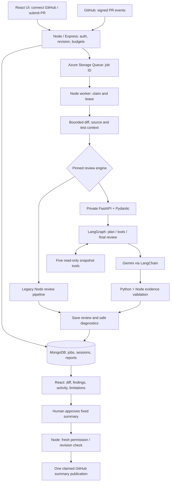

# PRism AI

**Evidence-based pull request reviews, with a bounded AI agent and human control over GitHub publishing.**

PRism connects a GitHub PR to a saved review: the actual diff, a change walkthrough, potential risks, findings linked to source lines, and visible coverage limits. It is a full-stack + AI engineering portfolio project focused on an explainable review pipeline.

**[Open the live app](https://prism-demo-standard-web.icypebble-5f4a6cbb.malaysiawest.azurecontainerapps.io/)** · **[Read-only sample](https://prism-demo-standard-web.icypebble-5f4a6cbb.malaysiawest.azurecontainerapps.io/demo)** · [Setup](docs/SETUP.md) · [Feature status](docs/FEATURE_ROADMAP.md)

> The public `/demo` is an owned synthetic PR with a captured, validated model response. Opening it makes no new model request. Live PR reviews require GitHub authorization, repository access and configured services. The existing Azure deployment uses the legacy engine; the new Python agent rollout is pending release verification.

## Try it in a minute

1. Open **Read-only sample** to inspect a diff and evidence-linked finding without signing in.
2. For an actual PR, connect GitHub, install the App on a selected repository and submit its PR URL from the homepage. Access to saved private reports is rechecked against GitHub.
3. Inspect the AI status, source evidence, omitted context and request metadata. A saved report can contain unavailable AI; completed job processing does not mean successful inference.
4. For Python-agent reports, review the fixed summary preview before explicitly approving a GitHub comment. PRism does not approve or merge a PR.

The Azure web app can scale to zero. Opening it may take time, and reliable cold webhook delivery is **not established**: recorded cold attempts exceeded GitHub's response deadline. Warm the app for a controlled demo and inspect GitHub deliveries. Scale to zero and request limits do not guarantee a zero bill or a monthly spending cap.

## What the project demonstrates

- **Full-stack integration:** React diff/report UI, Express API, GitHub App authentication, signed webhooks and MongoDB persistence.
- **Bounded agent behavior:** a private Python service chooses useful evidence tools within one authorized snapshot, then generates a structured review.
- **Grounding and validation:** Python and Node independently check paths, source quotes, coordinates and changed-line findings before accepting output. Traceable evidence can still support an incorrect conclusion; validators do not prove semantic correctness.
- **Durable job boundaries:** queue delivery, atomic claims, revision identities and Mongo checkpoints preserve reports and prevent blind model replay after uncertain failures.
- **Human-controlled publishing:** agent reports require explicit approval for a fixed summary; fresh GitHub permissions and PR revision are checked before writing.
- **Honest evaluation:** owned bug/clean/missing-context fixtures, failure records, offline contract tests and separately labelled live smoke tests.

## Architecture



Node owns GitHub credentials, authorization, queue/recovery, deterministic rules, storage and external writes. Python receives an already-authorized, bounded snapshot; it has no GitHub token, repository checkout, database or second queue. React renders reports and approval state.

**Stack:** React 19, Vite and CSS · Node.js 22 / Express 5 · MongoDB / Mongoose · Python 3.12+ / FastAPI / Pydantic · LangChain / LangGraph · Gemini · Azure Container Apps / Storage Queue · Docker.

### How the Python agent reviews

The agent can choose among these five tools; it cannot use arbitrary shell, filesystem, network, patch or merge tools.

| Tool | Actual capability |
| --- | --- |
| `inspect_pr_snapshot` | Inspect supplied PR intent and changed-file metadata |
| `read_source_window` | Read an allowlisted source ID within approved line bounds |
| `find_related_tests` | Inspect supplied nearby tests; never execute them |
| `search_review_context` | Rank approved chunks with lexical keyword matching |
| `run_review_rules` | Inspect Node's supplied deterministic rule signals |

Default budgets are **3 provider requests including retries, 2 decision rounds and 4 tool executions**, with one request reserved for the final review. The shared agent deadline is 90 seconds; each provider attempt gets at most 30 seconds or the remaining time. For supported Gemini 3 models, planning uses **low** thinking and the final review defaults to **medium**. Output and source-context limits remain finite.

The agent uses **lexical retrieval**, without embeddings or a vector database. Optional Chroma semantic retrieval belongs to the legacy path and is disabled unless configured. Neither path is a complete repository index.

Repository content is untrusted input. Structural allowlists restrict tool scope; invalid decisions, evidence rejection, truncation and missing context remain visible. Empty findings mean no supported finding was returned within that run's scope, not that the PR is safe. This is prompt/context engineering, not model-weight fine-tuning.

See [agent contracts, tool limits and failure behavior](docs/PYTHON_REVIEW_AGENT.md) and [review-quality investigation](docs/REVIEW_QUALITY.md).

### Recovery and external writes

Queued jobs pin their engine when created. Duplicate queue delivery is handled through durable job IDs and atomic claims. Mongo checkpoints can resume saving a received, validated result; **Python has no durable mid-loop resume**. If a model request or Node/Python response has an uncertain outcome, PRism marks it unknown rather than automatically calling the model again. This is not exactly-once model billing.

Agent reports suppress legacy automatic summary, inline and status writes. An authorized user may approve or reject the server-generated fixed summary. Duplicate approval uses an atomic publication claim; uncertain writes reconcile against the App's stable marker without posting again. GitHub and MongoDB cannot share a transaction, and a PR can change between the final read and write.

Opt-in review-ready email requires configured SMTP, a connected user, a GitHub-verified email address and current repository access. It is disabled by default; source code is not included in the notification.

## Run locally

Use Node.js **22.12+**, npm and, for the agent, Python **3.12+** with **uv**. Commands below use PowerShell from the repository root.

### Read-only sample: no credentials or model calls

```powershell
npm ci --prefix server
npm ci --prefix client
npm run build
$env:DEMO_ONLY='true'
$env:NODE_ENV='production'
npm start --prefix server
```

Open **http://localhost:5000/demo**. Stop with Ctrl+C, then remove `Env:DEMO_ONLY` and `Env:NODE_ENV` before starting normal development. Demo-only mode disables live review/auth/webhook routes and does not require MongoDB.

### Full application and agent

Install root dependencies with `npm ci`. On first setup, copy `server/.env.example` to `server/.env`; preserve an existing file. Configure GitHub App credentials, MongoDB and the chosen engine using [the setup guide](docs/SETUP.md), then run `npm run dev`.

- Frontend: **http://localhost:5173/**
- API health: **http://localhost:5000/api/health**
- Scripted Node → FastAPI → LangGraph → React example: [local agent demo](docs/PYTHON_REVIEW_AGENT.md#run-the-free-local-fixture)

The scripted example substitutes provider/GitHub responses. Real inference is a separate, explicitly configured path and may consume provider quota or money.

## Checks and evidence

Run the offline suite and build without making paid model requests:

```powershell
uv sync --project agent-service --frozen
powershell -ExecutionPolicy Bypass -File scripts/verify-local.ps1
```

Individual checks:

```powershell
uv run --project agent-service pytest agent-service/tests -q
uv run --project agent-service ruff check agent-service/app agent-service/tests agent-service/evaluations
npm test --prefix server
node --test client/test/*.test.js
uv run --project agent-service python server/test/evaluation_test.py
npm run build
```

Use `scripts/verify-local.ps1 -Integration` for isolated real MongoDB/Azurite checks, and `-Docker` to build both images. Local services/Docker must be running; these checks use owned fixtures and mocked external transports. See [setup](docs/SETUP.md#verification) for commands and evaluator usage. `npm run test:gemini --prefix server` is a separate **live provider call**, excluded from the offline checks.

| Evidence | What it establishes |
| --- | --- |
| Release checks | 40 Python tests, Ruff, 187 Node tests with 2 opt-in integration skips, 68 frontend tests, 7 scorer tests and client build; both opt-in real Mongo/Azurite integration suites passed separately |
| Real Node HTTP → FastAPI → Gemini smoke | One correct Boolean-bug finding with a validated report: 12.259 seconds, 4,101 reported tokens |
| Owned evaluation cases | Regression coverage for bugs, correct code, injected instructions and missing context; not independent adjudication |
| Public sample | Read-only rendering of captured output; no fresh inference |

Independent finding precision/recall is **unknown**. One successful smoke is not a benchmark, latency promise or evidence of reliable detection across real repositories. Offline tests do not prove live GitHub delivery, SMTP inbox delivery, hosted CI or cloud activation of the Python agent. [Quality evidence and unresolved limits](docs/REVIEW_QUALITY.md) · [current verification ledger](docs/FEATURE_ROADMAP.md).

## Source and learning map

| Start here | Responsibility / concept |
| --- | --- |
| [`client/src/features/dashboard/`](client/src/features/dashboard/) | PR submission, progress, diff/report UI and human approval |
| [`server/src/features/pullRequest/`](server/src/features/pullRequest/) | GitHub access, webhook signatures, commands and bounded context gathering |
| [`server/src/features/analysis/`](server/src/features/analysis/) | Rules, revision jobs, persistence, checkpoints, notification/publication boundaries |
| [`server/src/features/ai/ai.agent.js`](server/src/features/ai/ai.agent.js) | Private HTTP contract and independent Node evidence checks |
| [`agent-service/app/review/workflow.py`](agent-service/app/review/workflow.py) | LangGraph state, tool decisions, request budgets and stop conditions |
| [`tools.py`](agent-service/app/review/tools.py), [`retrieval.py`](agent-service/app/review/retrieval.py) | Snapshot allowlists and lexical retrieval |
| [`llm_client.py`](agent-service/app/review/llm_client.py), [`validation.py`](agent-service/app/review/validation.py) | Structured provider calls and evidence validation |
| [`metrics.py`](agent-service/app/review/metrics.py), [`evaluations/`](agent-service/evaluations/) | Safe usage/cost metadata and offline evaluation |
| [`infra/main.bicep`](infra/main.bicep), [CI workflow](.github/workflows/checks.yml) | Azure resources, scale settings and deployment checks |

For an engineering walkthrough, follow **signed event → durable job → bounded context → agent decision/tool → validation → saved report → explicit publication approval**. The important boundaries are authorization, source scope, ambiguous failures and human decisions.

## Further documentation

- [Setup and operations](docs/SETUP.md): GitHub App, local Mongo/Azurite, engines, email, retrieval and deployment configuration.
- [Python review agent](docs/PYTHON_REVIEW_AGENT.md): contracts, security, recovery, local fixtures and evidence matrix.
- [Review quality](docs/REVIEW_QUALITY.md): observed failures, repairs, live results and limits.
- [Feature roadmap](docs/FEATURE_ROADMAP.md): implemented versus pending work and release evidence.
- [Feature cheatsheet](docs/FEATURE_CHEATSHEET.md): existing review controls and service flow.
