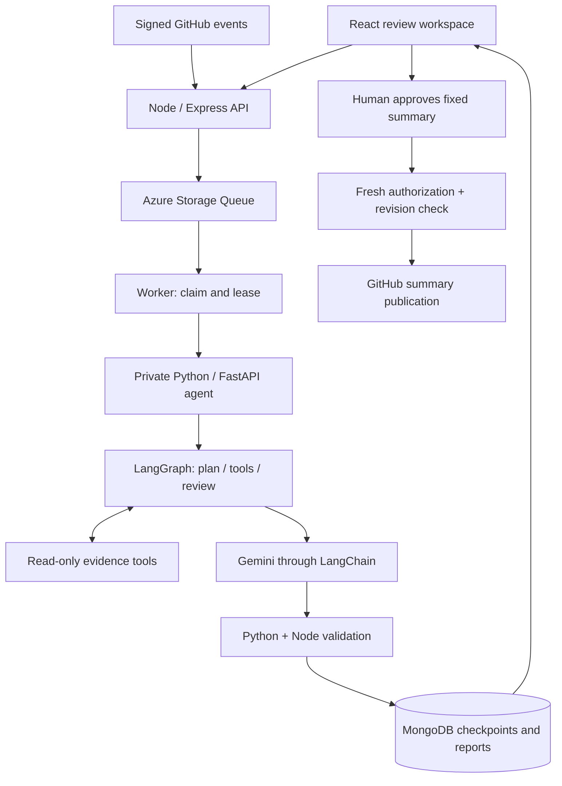

# PRism AI

### Agentic pull-request reviews with source evidence, durable jobs and human-controlled publishing

PRism brings together a React review workspace, a Node.js orchestration backend and a private Python agent. It turns GitHub PR changes into structured findings with source evidence, a change walkthrough and visible coverage limits.

[Read-only hosted demo](https://prism-demo-standard-web.icypebble-5f4a6cbb.malaysiawest.azurecontainerapps.io/demo) · [Current agent source](https://github.com/tarun5004/prism-ai/tree/feat/bounded-python-review-agent) · [Setup guide](https://github.com/tarun5004/prism-ai/blob/feat/bounded-python-review-agent/docs/SETUP.md) · [Release evidence](https://github.com/tarun5004/prism-ai/blob/feat/bounded-python-review-agent/docs/FEATURE_ROADMAP.md)

> **Source map:** the current Python-agent implementation is on [`feat/bounded-python-review-agent`](https://github.com/tarun5004/prism-ai/tree/feat/bounded-python-review-agent). This default branch still contains the earlier manual-submission beta. The architecture and agent capabilities below refer to the linked current implementation; use that branch for the full application. No branch merge is implied.

## What I implemented

| Area | Engineering work |
| --- | --- |
| Review interface | React diff/report views, findings linked to source lines, walkthroughs, activity and visible AI/coverage status |
| GitHub integration | App authentication, repository authorization, signed webhooks and PR revision identities |
| Agent service | Private FastAPI/Pydantic boundary with a LangGraph plan/tool/review workflow and Gemini through LangChain |
| Tool calling | Five allowlisted, read-only tools over an authorized snapshot; no arbitrary shell or repository write access |
| Grounding | Structured output plus independent Python/Node checks for paths, source quotes, coordinates and changed-line findings |
| Durable jobs | Azure Storage Queue, atomic worker claims, MongoDB job/report persistence and checkpoint recovery |
| Controlled writes | Explicit approval of a fixed summary, fresh permission/revision checks, publication claims and uncertain-write reconciliation |
| Cloud and delivery | Azure Container Apps, private agent ingress, managed queue identities, Bicep, Docker and a multi-runtime GitHub Actions workflow |

## Architecture



Node owns credentials, authorization, jobs, recovery and external writes. Python receives bounded source context and owns the per-request agent graph; it has no GitHub token, checkout, database or second queue.

## Agent and retrieval design

The agent can choose `inspect_pr_snapshot`, `read_source_window`, `find_related_tests`, `search_review_context` and `run_review_rules`. Its defaults allow **3 provider requests including retries, 2 decision rounds and 4 tool executions**, within a shared deadline. One request is reserved for the final structured review.

The agent retrieves from approved context with lexical ranking. Optional Chroma semantic retrieval belongs to the legacy Node path and is configuration-dependent; this is not a complete repository index. Evidence validation checks grounding, not whether every model conclusion is correct.

[Agent contracts and tools](https://github.com/tarun5004/prism-ai/blob/feat/bounded-python-review-agent/docs/PYTHON_REVIEW_AGENT.md) · [Review-quality investigation](https://github.com/tarun5004/prism-ai/blob/feat/bounded-python-review-agent/docs/REVIEW_QUALITY.md)

## Stack

- **Frontend:** React, Vite and JavaScript.
- **Backend and persistence:** Node.js, Express, MongoDB and Mongoose.
- **AI:** Python, FastAPI, Pydantic, LangChain, LangGraph and Gemini; a legacy provider/retrieval path remains available.
- **Cloud:** Azure Container Apps, Storage Queue, managed identities and Bicep infrastructure.
- **Delivery:** Docker, GitHub Actions, Node/Python checks, Mongo/Azurite integration fixtures and container smoke checks.

## Run the current agent version

Use Node.js **22.12+**, Python **3.12+**, npm and uv. Check out the implementation branch explicitly:

```bash
git clone --branch feat/bounded-python-review-agent https://github.com/tarun5004/prism-ai.git
cd prism-ai
```

For a read-only sample with no GitHub credentials or model calls, use PowerShell:

```powershell
npm ci --prefix server
npm ci --prefix client
npm run build
$env:DEMO_ONLY='true'
$env:NODE_ENV='production'
npm start --prefix server
```

Open `http://localhost:5000/demo`. The sample uses a captured, validated model response, not a new inference request. Stop the server and remove those environment overrides before normal development.

For the complete application, follow [setup and environment configuration](https://github.com/tarun5004/prism-ai/blob/feat/bounded-python-review-agent/docs/SETUP.md). GitHub App access, MongoDB, queue mode and the private agent require their documented configuration; never commit credentials.

## CI/CD and verification

The [workflow](https://github.com/tarun5004/prism-ai/blob/feat/bounded-python-review-agent/.github/workflows/checks.yml) defines Python tests/Ruff, backend and frontend checks, Mongo/Azurite integration, image builds and container smoke checks. Azure deployment is an explicit, branch-gated workflow dispatch. Workflow source does not mean a particular hosted run passed: the release ledger records a GitHub billing lock at the latest acceptance snapshot.

From the agent branch, the offline verification entry point is:

```powershell
uv sync --project agent-service --frozen
powershell -ExecutionPolicy Bypass -File scripts/verify-local.ps1
```

The [18 November release ledger](https://github.com/tarun5004/prism-ai/blob/feat/bounded-python-review-agent/docs/FEATURE_ROADMAP.md#2026-11-18-agent-release-accepted-on-azure) records an actual queued Azure agent review of an owned PR, alongside local checks and unresolved limits. Those are dated results, not fresh tests from this README edit.

## Important boundaries

- Reports are advisory; PRism does not approve or merge a PR. The agent publication path requires explicit human approval.
- Checkpoints can recover saving a received result; they do not resume the Python graph mid-loop or guarantee exactly-once model billing.
- The hosted app can scale to zero. Reliable cold webhook delivery is not established; opening the demo is separate from proving a live PR review.
- Missing context, partial output and uncertain model outcomes remain visible. The project does not claim general accuracy or commercial-tool parity.

## Earlier beta on this default branch

The source currently checked out on `main` implements manual PR submission, transparent diff rules, an optional JSON AI endpoint and MongoDB/in-memory history. Its product requirements remain in [the beta documentation](docs/PRISM_BETA_V0_REQUIREMENTS.md). Use the agent-branch links above for the newer implementation and deployment documentation.
