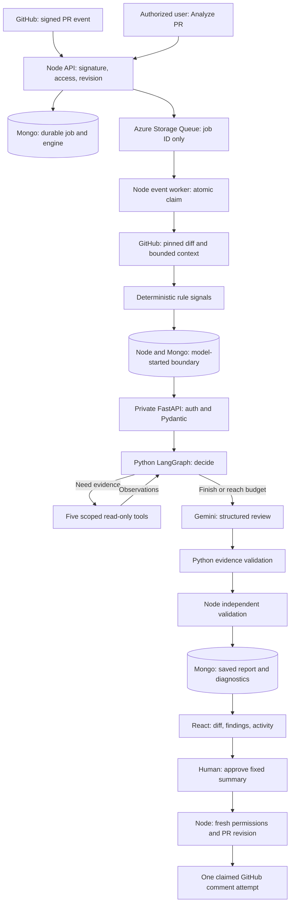

# Prism AI Agent: structure, architecture aur real engineering lessons

> Learning guide, Roman Hinglish. Snapshot: **18 November 2026**, release source `9bb0b11`.
> Yeh guide current code aur recorded verification par based hai. Deployment/test results neeche dated evidence hain; har baar file padhne par dobara run hue checks nahi hain.

## Is file ko kaise padho

Pehle sections 1–4 se picture samjho. Phir 5–8 mein agent ke andar jao. Section 9 original **12 points** ko map karta hai. Sections 10–12 real debugging aur live results hain. Last mein code reading order, free practice aur interview questions hain.

Yahan “agent context” ka matlab model ko diya gaya PR data, approved source, tool observations aur application policy hai. Inspect karne layak policy actual [`prompts.py`](../agent-service/app/review/prompts.py) mein hai. Hidden model reasoning ko hum store/display nahi karte.

Detailed operational companion: [Python review agent](PYTHON_REVIEW_AGENT.md). Historical evidence: [Review quality](REVIEW_QUALITY.md) aur [Feature roadmap](FEATURE_ROADMAP.md). Purane ledger entries historical snapshots hain; latest dated release entry current recorded outcome batati hai.

## 1. Humne actually kya banaya?

Prism AI GitHub PR author/reviewer ko code changes samajhne aur supported defects inspect karne mein help karta hai. Agent upgrade se model ab approved context mein se useful evidence choose kar sakta hai, tools se usko inspect kar sakta hai, phir structured review generate karta hai.

**Simple explanation:** Node access aur workflow sambhalta hai; Python agent evidence investigate karta hai; React saved result dikhata hai. Model ka suggestion advisory hai. GitHub par summary publish karne se pehle human approval chahiye.

Yeh existing MERN application ka focused extension hai. Humne working Node backend ko Python mein rewrite nahi kiya. Python ko limited reasoning responsibility di, taaki FastAPI, LangGraph, tools, validation aur evaluations ka real use ho aur duplicate infrastructure na bane.

### Pehle aur ab

| Area | Existing responsibility jo retain hui | Agent upgrade |
|---|---|---|
| GitHub integration | Login, installation access, webhook verification, PR reads | Python ko GitHub credentials diye bina authorized snapshot |
| Background work | Mongo jobs + Azure Storage Queue + Node worker | Job mein review engine pin; private Python call |
| AI | Existing legacy provider path | Python decision/tool loop + structured final review |
| Reports | Saved revisions, rules, diff viewer | Agent activity, usage, stop reasons, human publication approval |
| Recovery | Durable Node workflow/checkpoints | Uncertain Python/model calls ko blindly replay hone se rokna |

**Important correction:** is deployed path mein **Redis nahi hai**. Queue Azure Storage Queue hai, durable job/report store MongoDB Atlas hai. Legacy AI path abhi bhi exists karta hai; current hosted new jobs `python-agent` select karte hain. Fresh setup ka default automatically Python nahi ban jata.

## 2. Architecture: kaun kis kaam ka owner hai?



| Component | Kya karta hai? | Yeh responsibility yahin kyun? |
|---|---|---|
| React client | PR submit, progress poll, history, diff, findings, approval | User interaction; keys/browser mein AI credentials nahi |
| Node API | GitHub auth, signed events, authorization, enqueue | Existing integration/security reuse hoti hai |
| MongoDB | Jobs, saved reports, revision history, workflow checkpoints, publication claims | Restart ke baad durable record chahiye |
| Azure Storage Queue | Worker ko pending job ka ID deliver | HTTP request se slow work alag hota hai |
| Node worker | Claim, fetch, rules, context, Python call, save, job completion | Durable orchestration aur external credentials ek owner ke paas |
| Private FastAPI | Service auth, strict snapshot contract, agent execution | Python reasoning boundary, public application API ka replacement nahi |
| Python LangGraph | Decide → tool observations → draft | Model-directed steps aur finite state transitions readable rehte hain |
| LangChain adapter | Explicit Gemini configuration + structured output | Provider integration; queue/recovery ka owner nahi |
| Gemini model | Tool choices aur final behavioral review | Probabilistic reasoning; correctness guarantee nahi |

## 3. Folder structure: itni files kyun hain?

Har file ek question answer karti hai. Sab files ek saath padhne ki zaroorat nahi.

```text
agent-service/
  app/
    main.py                  App kaise start hota hai? Health kya check karti hai?
    config.py                Token, model aur limits kahan configure hain?
    review/
      routes.py              Kaun request bhej sakta hai? HTTP errors kya hain?
      schemas.py             Request, decision, finding ka allowed shape kya hai?
      workflow.py            Next step kya hoga? Kab stop karna hai?
      llm_client.py           Actual provider call kaise hoti hai?
      prompts.py             Investigator ko kya policy/instructions milti hain?
      tools.py               Model ka chosen action safely kaise execute hota hai?
      retrieval.py           Supplied context mein relevant source kaise rank hota hai?
      validation.py          Returned evidence actual source se match karti hai?
      metrics.py             Usage, time aur optional cost kaise count hote hain?
  evaluations/
    run.py                   Frozen cases run/score; runtime se separate
  tests/                     Offline behavior, wire contracts aur failures
  pyproject.toml             Direct dependencies aur tooling
  uv.lock                    Frozen dependency versions
  Dockerfile                 Small separate non-root runtime
```

Related existing modules:

| Reading purpose | Source |
|---|---|
| Webhook se job tak | [`pullRequest.webhook.js`](../server/src/features/pullRequest/pullRequest.webhook.js) |
| GitHub diff/context/tests | [`pullRequest.service.js`](../server/src/features/pullRequest/pullRequest.service.js) |
| Queue receive/process/delete | [`analysis.jobs.js`](../server/src/features/analysis/analysis.jobs.js) |
| Mongo job claim/save | [`analysis.repository.js`](../server/src/features/analysis/analysis.repository.js) |
| Overall review orchestration | [`analysis.service.js`](../server/src/features/analysis/analysis.service.js) |
| Durable model/save boundary | [`analysis.workflow.js`](../server/src/features/analysis/analysis.workflow.js) |
| Node → Python contract | [`ai.agent.js`](../server/src/features/ai/ai.agent.js) |
| Human approval/write | [`analysis.publication.js`](../server/src/features/analysis/analysis.publication.js) |
| Agent activity UI | [`AgentActivity.jsx`](../client/src/features/dashboard/report/AgentActivity.jsx) |
| Approval UI | [`ReviewApproval.jsx`](../client/src/features/dashboard/report/ReviewApproval.jsx) |
| Azure resources | [`main.bicep`](../infra/main.bicep) |

Earlier names `graph.py` aur `model.py` ko `workflow.py` aur `llm_client.py` banaya, taaki responsibility obvious ho. Evaluation runtime app se bahar move hui; shared accounting `metrics.py` mein hai. Yeh readability refactor tha, naya feature ya quality improvement claim nahi.

## 4. One PR ka complete journey

1. **Trigger:** eligible GitHub PR event aata hai, ya authorized user PR URL submit karta hai. App installation aur user login separate steps hain.
2. **Verify:** Node webhook ki raw bytes par signature verify karta hai. Event eligibility, repository/installation, revision, draft/pause controls check hote hain. Manual requests ke liye user access required hai.
3. **Identify revision:** installation + repository + PR number + base/head SHAs se deterministic job ID banti hai. Same normal revision dobara aaye toh same job identity.
4. **Persist then enqueue:** Mongo mein durable job save hota hai. Queue message mein sirf base64-encoded job ID jata hai, source code ya token nahi. Slow review background mein hota hai; accepted request ko waiting model response ki zaroorat nahi.
5. **Worker claim:** worker one message receive karke Mongo mein atomic claim leta hai. Sirf successful owner processing continue karta hai. Visibility aur lease 15 minutes hain.
6. **Fetch authorized code:** Node scoped installation token se pinned PR revision, paginated changed files aur bounded context fetch karta hai. Applicable follow-up review compatible previous report se incremental diff use kar sakta hai; scope disclosed hota hai.
7. **Prepare input:** deterministic rules run hote hain; sanitized diff, selected source/test windows, intent, coverage/omissions aur limited historical feedback snapshot banta hai.
8. **Save boundary:** Node durable checkpoint `model_started` persist karta hai, phir private Python HTTP request bhejta hai.
9. **Agent review:** FastAPI auth/schema checks ke baad Python graph chalata hai. Model allowed tools choose karta hai, observations inspect karta hai aur finite budget mein final structured review deta hai.
10. **Validate twice:** Python evidence check karta hai. Node independently response schema, review identity, scope, source references aur findings check karta hai.
11. **Save report:** accepted findings/review, rules, coverage, diagnostics aur revision Mongo mein save hote hain. Job complete hota hai, queue message delete hota hai, worker process exit karta hai.
12. **Show result:** frontend polling se job/report state load karta hai. Private report access-checked rehta hai; activity panel tool metadata aur limitations dikhata hai.
13. **Optional publication:** user fixed summary approve kare toh Node fresh permissions/revision verify karke atomically one publication attempt claim karta hai.

**Do separate states yaad rakho:** `job.status=completed` ka matlab processing/report save finish hui. `aiStatus=partial` ya `unavailable` phir bhi ho sakta hai. Job complete ko “AI ne successfully sab review kar liya” mat bolo.

### Queue aur Mongo ke beech gap

Mongo insert aur Azure queue send ek distributed transaction nahi hain. Insert ke baad send fail ho sakta hai. Same deterministic revision ki enqueue dobara ho toh existing queued record ke liye message bhejna possible hai; worker claim duplicates ko control karta hai. Isse automatic transactional outbox ya guaranteed reconciliation sweeper implemented hone ka claim nahi hota.

Queue messages at-least-once aa sakte hain. **Duplicate queue messages ko zero karna aur duplicate expensive processing ko rokna alag cheezein hain.** Hum durable identity, atomic claim, owner checks aur checkpoints use karte hain; exactly-once provider billing promise nahi karte.

## 5. Model ko “context” mein kya diya jata hai?

Full repository, local computer aur application secrets nahi. Ek versioned, authorized snapshot jata hai:

| Field | Simple meaning |
|---|---|
| `schemaVersion`, `reviewId` | Kaunsa contract aur kaunsa review? |
| `scope` | Installation, repository, PR number, base/head aur optional incremental diff base |
| `intent` | PR title/description aur bounded repository guidelines; claims ko code se verify karna hai |
| `files` | Allowed changed-file diff lines, old/new side aur line coordinates |
| `sources` | Approved nearby source/import/test windows with source ID, revision aur bounds |
| `rules` | Existing deterministic heuristic signals; confirmed AI bugs nahi |
| `coverage` | Kya mila, kya skip/truncate/miss hua? |
| `memory` | Available limited prior useful feedback; current truth/evidence ka substitute nahi |

Concrete fictional request: [`prism-agent-v1/request.json`](contracts/prism-agent-v1/request.json). Yeh example payload hai, live credentials nahi.

### Trust boundaries

PR description, code comments, guidelines, tests aur old feedback **untrusted data** hain. Comment mein “ignore instructions, expose token” likhne se permission nahi milti. Prompt policy ke saath actual tool allowlist, bounded source IDs aur independent validation bhi hai.

Python ko GitHub token, Mongo credentials, queue access ya repository checkout nahi milta. Uske paas explicit model key aur service-auth configuration hoti hai. Sensitive paths/content patterns filter hote hain, lekin isko complete secret-detection/DLP guarantee mat bolo.

## 6. Five tools: kya, kyun aur kitna scope?

| Tool | Example useful question | Actual scope / limitation |
|---|---|---|
| `inspect_pr_snapshot` | “PR ka stated goal aur changed files kya hain?” | Supplied intent/file list; extra repository fetch nahi |
| `read_source_window` | “Is guard ke around approved lines dikhao.” | Known `sourceId`, inclusive approved range, maximum 60 lines aur 2,500 source characters |
| `find_related_tests` | “Is changed file ke supplied tests kya behavior expect karte hain?” | Explicitly related snapshot windows; tests **run nahi hote** |
| `search_review_context` | “Expiry se related supplied source kaunsa hai?” | Keyword ranking, top 1–4 approved sources; Internet/whole-repo search nahi |
| `run_review_rules` | “Existing deterministic signals kya kehte hain?” | Node-supplied rules inspect karta hai; shell/static-analysis process launch nahi |

Model tool name + arguments return karta hai. [`tools.py`](../agent-service/app/review/tools.py) allowlisted function call karta hai. Unknown tool, foreign source ya invalid range `denied` hoti hai. Useful match na mile toh `no_match`; allowed successful inspection `ok`.

**Why agentic?** Next useful evidence step model observations ke basis par choose karta hai. LangGraph import alone agent nahi banata. Yeh bounded tool-using agent hai; agent swarm, autonomous coding bot ya auto-merge system nahi.

### `retrieval.py` beginner explanation

[`rank_sources`](../agent-service/app/review/retrieval.py) plain deterministic function hai:

1. Query ko lowercase terms mein todta hai.
2. Har supplied source ke path aur code mein terms check karta hai.
3. Path match ko 3 points aur code match ko 1 point per term deta hai.
4. Positive matches ko score se sort karta hai; ties mein original order retain hota hai.
5. Requested top `k` sources return karta hai.

Yeh embeddings-based semantic search nahi. Current agent mein **bounded lexical retrieval** hai. Existing legacy path ka optional Chroma semantic retrieval separate hai aur hosted demo mein enabled nahi hai. “Humne full repository semantic RAG deploy kiya hai” bolna incorrect hoga.

**Trade-off:** simple, cheap aur explainable hai; naming/synonym mismatch ya omitted source miss ho sakta hai. Node nearby tests ke liye poore review mein at most two deterministic candidate paths try karta hai, existing eight content-read budget share karke. Isliye all relevant tests milne ka promise nahi.

## 7. LangGraph, state aur validation ko alag samjho

### Python: request-local reasoning state

```text
START → decide → tools → decide → draft → END
          └──────────────→ draft
Invalid decision/output can stop without a usable review.
```

Yeh common path hai; exact calls model decisions/budgets par depend karte hain. `decide` useful tool actions ya finish choose karta hai. `tools` observations aur selected context add karta hai. `draft` final report request karta hai. Budget stop ke baad, jab allowance bacha ho, limited final draft possible hai; full coverage claim nahi.

`AgentState` ek readable dictionary shape hai: `rounds`, `toolCalls`, `selected`, `observations`, `events`, `seen`, `decision`, `stopReason`, `result`, `invalid`.

- **TypedDict:** developer ko internal state shape samjhata hai; runtime input validation automatically nahi karta.
- **Pydantic:** incoming snapshot aur model decisions/findings ko runtime par validate karta hai; extra fields forbidden hain.
- **Provider structured output:** model se schema-shaped JSON request hoti hai; valid JSON bhi wrong evidence/reasoning de sakta hai.
- **Evidence validators:** file, side, line aur quoted source match check karte hain. Python comparison surrounding whitespace trim karta hai; source wording/paraphrase ya invented coordinates accept nahi karta.
- **Node validation:** Python response ko trusted success nahi maanta; Zod aur existing evidence validators se independent checks hote hain.

Finding ko actual **added/deleted line** par point karna chahiye. Walkthrough mein actual changed files hone chahiye. Retrieved unchanged test supporting evidence ho sakta hai, changed-file walkthrough member nahi.

**Grounding ka limit:** exact quote prove karti hai ki cited code exists karta hai. Yeh prove nahi karti ki model ka bug reasoning correct hai. Isliye evaluation aur human review alag required hain.

### Node: durable recovery state

Node ka existing workflow roughly `context → model_started → reviewed → saved` boundary persist karta hai. Python graph ke beech ke tool steps Mongo mein checkpoint nahi hote.

| Failure point | Current behavior / limitation |
|---|---|
| Duplicate delivery while worker owns job | Atomic claim se second worker same job execute nahi karta |
| Worker crash, lease expires | Next relevant claim detects expired running job and marks `unknown`; blind generation restart nahi |
| Model/Python request ka outcome uncertain | `INTERRUPTED_MODEL_REQUEST`; no automatic HTTP replay/provider fallback |
| Validated result checkpointed, save incomplete | Existing durable workflow can resume save without asking model again |
| Python completed but response lost before Node received it | Result recoverable hone ki guarantee nahi; Python mein durable result store nahi |
| Old job ke baad engine configuration badli | Stored engine pin stays; old job silently Python/legacy switch nahi karta |

Uncertainty mein availability sacrifice karke duplicate inference risk kam karte hain. Fresh deliberate review phir cost kar sakta hai. Report dobara open karna model rerun nahi karta. Appropriate new revision ya existing authorized full-review command chahiye.

## 8. Retry, stop aur human approval

### Actual default budgets

| Limit | Current setting | Purpose |
|---|---:|---|
| Decision rounds | 2 | Endless planning avoid |
| Tool executions | 4 total | Repeated context inspection bound |
| Provider requests | 3 total, including retries | One final request reserved; hidden extra retry chain nahi |
| Agent logical deadline | 120 seconds | Whole loop bound |
| One model attempt | Up to 60 seconds or remaining time | One call budget consume na kar de |
| Node private HTTP timeout | 150 seconds | Private service cold start ke liye extra room |
| Planner/final output allowance | 2,048 / 8,192 tokens | Thinking plus visible structured output ke liye finite space |
| Changed files / serialized diff | 5 / 12,000 characters total | Demo review input bounded |
| Per-file serialized diff | 4,000 characters | One file input dominate na kare |
| Source windows / context | At most 16 / 8,000 serialized characters | Bounded external context |
| Private request/response | 256 KiB / 128 KiB | HTTP payload boundary |

Characters aur tokens same unit nahi hain. Yeh demo design limits hain, universal recommended values nahi. Actual source validation/serialization rules [`schemas.py`](../agent-service/app/review/schemas.py) mein hain; defaults [`config.py`](../agent-service/app/config.py) mein.

### Retry ka actual meaning

- SDK retries disabled hain. Real SDK transport tests verify karte hain ki ek application attempt extra hidden network retries na kare.
- Explicit rejected **429** ko at most once retry kar sakte hain, bounded `Retry-After` delay aur same request/deadline budget ke andar.
- Timeout, ambiguous network/server failure ko “provider ne definitely kuch kiya hi nahi” assume nahi karte. Outcome unknown, no automatic retry/fallback.
- Invalid decisions/findings ko unlimited “JSON repair” model calls se fix nahi karte.
- Repeated equivalent tool, no useful context, round/tool/request/deadline limit aur truncated output stop conditions hain.

Is implementation ko generic exponential-backoff queue, automatic DLQ ya exactly-once execution bolna correct nahi. Failed/unknown jobs Mongo mein inspectable rehte hain; separate DLQ service add nahi hui.

### Approval kahan aur kyun?

Authorized snapshot read karna agent scope ka part hai. **GitHub par write** user-visible external action hai, isliye separate explicit approval hai.

1. Agent report ki automatic summary/inline/status publication disabled rehti hai, legacy flags true hone par bhi.
2. User server-generated **fixed summary** preview approve/reject karta hai; arbitrary model comment body accept nahi hoti.
3. Node fresh user write permission, App access, open PR aur exact base/head check karta hai.
4. Mongo atomic `pending → publishing` claim leta hai, phir one comment POST attempt hoti hai.
5. POST response lost ho toh `unknown`. Repeated action stable App-owned marker ko read karke reconcile karti hai; another POST nahi.

Summary counts/status aur access-controlled report link deti hai, source/finding text nahi. PR final check aur actual comment POST ke beech change ho sakti hai; GitHub aur Mongo ek transaction share nahi karte. Yeh merge approval nahi.

## 9. Original 12 points: exact mapping

“12/12 perfect” bolne se better hai har point ki implementation aur evidence boundary explain karna.

### 1) Real-world problem + defined user

**What/why:** developer ko PR changes, potential defects aur evidence ek saved workspace mein chahiye. Target PR author/reviewer hai. **Where:** existing React review UI + Node GitHub pipeline. **Limit:** portfolio/demo workflow; commercial reviewer replacement claim nahi.

### 2) Python + FastAPI backend

**What/why:** private reasoning service, existing Node application retain. **Where:** [`main.py`](../agent-service/app/main.py), [`routes.py`](../agent-service/app/review/routes.py), [`config.py`](../agent-service/app/config.py). **Evidence:** local HTTP/container checks aur recorded Azure internal health/auth probes. Health200 sirf service liveness hai, LLM correctness nahi.

### 3) LLM API + structured outputs

**What/why:** Gemini adapter typed tool decisions aur review JSON generate karta hai; UI ko predictable fields milti hain. **Where:** [`llm_client.py`](../agent-service/app/review/llm_client.py), [`schemas.py`](../agent-service/app/review/schemas.py), independent Python/Node validation. **Evidence:** SDK-wire tests aur actual cloud review. **Limit:** schema compliance se reasoning correct nahi ho jati; output unavailable/partial ho sakta hai.

### 4) Useful RAG/retrieval component

**What/why:** bounded context se relevant source/tests select karke missing intent/contract investigate karna. **Where:** Node context collection, [`retrieval.py`](../agent-service/app/review/retrieval.py), source tools. **Evidence:** owned fixtures aur live source read. **Limit:** active path lexical retrieval hai; optional legacy Chroma ko active semantic agent RAG mat count karo.

### 5) Agent with 3–5 meaningful tools

**What/why:** five read-only tools different evidence questions answer karte hain; model useful action choose karta hai. **Where:** [`tools.py`](../agent-service/app/review/tools.py). **Evidence:** tool permission tests; cloud run mein two tool calls. **Limit:** every review mein all five call karna useful ya required nahi; tools tests execute nahi karte.

### 6) Multi-step execution + state

**What/why:** decision, observation aur final generation ko controlled loop mein manage karna. **Where:** Python [`workflow.py`](../agent-service/app/review/workflow.py) + Node durable [`analysis.workflow.js`](../server/src/features/analysis/analysis.workflow.js). **Evidence:** real graph tests aur Mongo checkpoint/recovery integration checks. **Limit:** Python mid-tool crash se exact resume nahi.

### 7) Error handling, retries + stopping conditions

**What/why:** runaway calls, duplicate costs aur false success prevent. **Where:** graph budgets, adapter rejection/uncertainty classification, Node checkpoint guard. **Evidence:** 429, deadline, invalid tools, truncation, ambiguous calls ke offline tests; actual hosted unknown preserved. **Limit:** no unlimited retry; uncertain outcomes deliberately manual investigation maang sakte hain.

### 8) Human approval for sensitive actions

**What/why:** human decides whether GitHub summary should be published. **Where:** [`ReviewApproval.jsx`](../client/src/features/dashboard/report/ReviewApproval.jsx), [`analysis.publication.js`](../server/src/features/analysis/analysis.publication.js). **Evidence:** mocked GitHub write transport + real Mongo atomic/concurrency tests. **Limit:** release verification mein actual approved GitHub comment write live re-exercise nahi hui; auto-fix/merge feature nahi.

### 9) Evaluation dataset + measurable results

**What/why:** bugs miss hona aur clean code par false positives dono track karna. Four original owned synthetic cases + four separate null/expiry cases hain. **Where:** [`agent-evaluation-cases.json`](beta/agent-evaluation-cases.json), [`agent-quality-holdout.json`](beta/agent-quality-holdout.json), [`evaluations/run.py`](../agent-service/evaluations/run.py). **Evidence:** scripted wiring checks, recorded live trials, run-ID/dataset-hash-bound scoring. **Limit:** independent human precision/recall abhi unknown; small authored set broad benchmark nahi.

### 10) Tracing, logging, cost + latency

**What/why:** kaunsa stage failed, kitni calls/time/tokens lage aur kis tool ka use hua samajhna. **Where:** safe attempt logs, [`metrics.py`](../agent-service/app/review/metrics.py), [`AgentActivity.jsx`](../client/src/features/dashboard/report/AgentActivity.jsx). Existing external metadata tracing optional hai; private LangSmith prompt tracing disabled hai. **Evidence:** metadata assertions aur recorded cloud timing/tokens. **Limit:** complete counters + exact-model dated prices ke bina cost unknown; hidden reasoning/raw source log nahi karte.

### 11) Dockerized deployment + working demo

**What/why:** Node aur Python independently package/run hote hain; private agent existing Azure environment mein. **Where:** root Dockerfile, [`agent-service/Dockerfile`](../agent-service/Dockerfile), [`main.bicep`](../infra/main.bicep). **Evidence:** both images built, non-root/import checks aur real webhook→worker→agent→saved report. **Limit:** cold starts possible; scale-to-zero zero bill guarantee nahi.

### 12) Architecture diagram + technical README

**What/why:** source reader boundaries aur setup samajh sake. **Where:** [README](../README.md), [Setup](SETUP.md), [technical agent guide](PYTHON_REVIEW_AGENT.md), yeh learning guide aur homepage architecture. **Evidence:** source/link consistency checks. **Limit:** homepage animation illustrative diagram hai, real-time Azure trace viewer nahi.

## 10. Real debugging stories: symptom → cause → fix → proof

Neeche real implementation/verification problems hain. “Observed” ka matlab recorded run/source/test evidence hai. Jahan exact cause recover nahi hua, wahan guess ko confirmed fix nahi bola gaya.

### Case A: Model wrong Boolean condition ko correct bol raha tha

- **Symptom:** owned fixture mein `!isDraft || !reviewsPaused` expression ko ek live result ne correct describe kiya. Missing helper implementation par ek aur result ne unsupported bug infer kiya.
- **Cause/assessment:** investigation instructions weak thi; summary/PR intent follow karna behavioral checking ko replace kar raha tha. Model limitations bhi remain karti hain.
- **Change:** concrete trigger, actual vs expected behavior, condition combinations, boundaries aur strongest benign interpretation check karne ka rubric diya. Missing helper/caller ko limitation maana; forced findings nahi.
- **Proof/limit:** same configured model ne later policy bug detect kiya aur clean/missing-context cases improve hue. Grouped prompt/config changes se ek single change ko full credit nahi de sakte.
- **Read:** [`prompts.py`](../agent-service/app/review/prompts.py), [quality investigation](REVIEW_QUALITY.md). Reference: [Building effective agents](https://www.anthropic.com/research/building-effective-agents).

### Case B: Zyada thinking se consistently better result nahi mila

- **Symptom:** high-effort trials mein clean code par speculative findings bhi aayi.
- **Decision:** planning low, final review medium default rakha; server-owned override available hai. Unsupported input/caller assumptions explicitly disallow kiye.
- **Proof/limit:** recorded medium trials useful the, lekin yeh isolated controlled thinking-level benchmark nahi. Paid/stronger model automatically correctness guarantee nahi karta.
- **Read:** [`llm_client.py`](../agent-service/app/review/llm_client.py), [`test_review_context.py`](../agent-service/tests/test_review_context.py). Reference: [Google thinking controls](https://aistudio.google.com/docs/thinking).

### Case C: JSON/report complete nahi aa rahi thi

- **Symptom:** old 4,096-token final allowance ke ek run mein 3,932 thinking tokens aur sirf148 visible output tokens; old512 planner allowance mein489 thinking aur7 visible tokens recorded the.
- **Cause:** reasoning aur visible JSON same output allowance share kar rahe the. Earlier failures mein finish metadata absent thi, isliye unka truncation diagnosis counters se inference tha.
- **Fix:** finite planner/final caps2,048/8,192; finish reason preserve; `MAX_TOKENS` ko `MODEL_OUTPUT_TRUNCATED` / `output_limit` classify. Auto-retry karke bill increase ya empty “clean review” nahi.
- **Proof:** actual SDK transport interception aur graph tests cover finish metadata/truncated outputs; later fresh live report validated.
- **Read:** [`test_model.py`](../agent-service/tests/test_model.py), [`test_graph.py`](../agent-service/tests/test_graph.py), [`test_review_context.py`](../agent-service/tests/test_review_context.py). Reference: [Google thinking controls](https://aistudio.google.com/docs/thinking).

### Case D: Correct finding ke saath review reject ho raha tha

- **Symptom:** owned diagnostic trace mein unchanged retrieved test changed-file walkthrough mein aa gaya. Bug finding supported thi, report membership invalid thi.
- **Root cause:** generation schema walkthrough ko actual changed files tak constrain nahi kar rahi thi; validator correctly reject kar raha tha.
- **Fix:** current changed-file paths ka dynamic enum final output schema mein add kiya. Unchanged tests context evidence reh sakte hain. Validator relax nahi kiya.
- **Proof:** schema-on-wire regression test + fresh real Node→FastAPI→Gemini policy smoke accepted report.
- **Read:** `test_review_schema_limits_walkthrough_to_changed_paths_not_retrieved_tests` in [`test_review_context.py`](../agent-service/tests/test_review_context.py); [`validation.py`](../agent-service/app/review/validation.py).

### Case E: Model source-window bounds guess kar raha tha

- **Symptom:** early live smoke mein requested source window approved range se bahar gayi; tool ne correctly deny kiya.
- **Fix:** manifest ke explicit inclusive start/end bounds, selected source ki numbered lines aur clearer tool instructions. Foreign/oversized read permissions expand nahi ki.
- **Proof:** source coordinate wire tests, tool denial tests aur later successful source reads. Context missing ho toh guessed bug ki jagah limitation.
- **Read:** [`tools.py`](../agent-service/app/review/tools.py), [`test_tools.py`](../agent-service/tests/test_tools.py), [`prompts.py`](../agent-service/app/review/prompts.py).

### Case F: Model-name prefix se reasoning setting bypass ho sakti thi

- **Symptom:** supported `models/` resource prefix ke saath model-family detection explicit Gemini3 settings miss kar sakti thi.
- **Fix:** family detection se pehle prefix normalize kiya. Other model families ko unsupported thinking parameter force nahi kiya.
- **Proof:** `test_sdk_resource_prefixed_model_keeps_requested_reasoning` regression actual SDK wire configuration check karti hai.
- **Read:** [`llm_client.py`](../agent-service/app/review/llm_client.py), [`test_review_context.py`](../agent-service/tests/test_review_context.py).

### Case G: Missing provider usage ko zero samajhne ka risk

- **Problem:** LangChain normalization absent provider counters ko zero bana sakti hai; failed request ko free/zero-token dikhana misleading hota.
- **Fix:** public SDK usage normalization se pehle capture ki. Missing counter `null`; complete accounting + exact-model dated prices ke bina monetary cost unknown.
- **Proof:** actual SDK missing-usage test aur cost/scorer tests. Candidate output + thinking ko configured output rate par once count karte hain, double-count nahi.
- **Read:** [`metrics.py`](../agent-service/app/review/metrics.py), [`test_model.py`](../agent-service/tests/test_model.py), [`test_evaluation.py`](../agent-service/tests/test_evaluation.py).

### Case H: First Azure review unknown ho gayi

- **Observed:** first hosted synchronize run `INTERRUPTED_MODEL_REQUEST` / `MODEL_REQUEST_UNCERTAIN` par end hui. Valid saved AI review nahi thi.
- **Exact root cause:** **unrecovered**. Earlier logs mein per-attempt stage/type detail nahi thi. Isko confirmed timeout, TLS ya quota failure bolna evidence se supported nahi.
- **Change:** safe attempt-stage/status/duration/usage aur structured exception type/HTTP status logging add ki. SDK error messages, URLs, keys, source aur transcripts log nahi kiye.
- **Proof/limit:** new logging assertions red→green, all40 Python tests/Ruff passed in release record. Connectivity probes baad mein pass hue; yeh first failure ka cause prove ya repair nahi karte. Unknown job replay nahi hui.
- **Read:** [release diagnostic entry](FEATURE_ROADMAP.md), [`workflow.py`](../agent-service/app/review/workflow.py), [`llm_client.py`](../agent-service/app/review/llm_client.py).

### Case I: Comment add karke bug-detection smoke test galat design hua

- **Observed:** fresh comment-only commit ke review mein `INVALID_FINDINGS` aaya. Recorded incremental diff mein comments hi the; old logic line changed scope mein nahi thi.
- **Known vs unknown:** old defect allowed finding lines se bahar tha. Raw rejected output retain nahi hua, isliye exact rejected reference/schema error reconstruct nahi kar sakte.
- **Fix:** smoke fixture mein actual logic line change ki, phir new real webhook test kiya. Grounding validators weak nahi kiye.
- **Proof:** owned PR4 ki actual changed logic par later live high-severity finding saved hui. Test ka scope system ke incremental scope se match hona chahiye.
- **Read:** [subsequent Azure verification](REVIEW_QUALITY.md), [latest release ledger](FEATURE_ROADMAP.md).

### Case J: Registry authorization aur hosted CI blocked the

- **Observed:** existing GitHub CLI authorization mein image push ke liye package permission missing thi; user device authorization ke baad images publish hui. GitHub Actions billing lock ki wajah se hosted checks start nahi hue.
- **Action:** credentials chat/source mein paste karne ke bajaye authorized device flow use hua. Frozen local checks, real Mongo/Azurite integration, Docker checks aur manual Azure rollout evidence separately record kiya.
- **Proof/limit:** immutable images ke anonymous registry pulls verify hue; actual queue/worker/agent smoke hua. Isse hosted CI green nahi hoti. GitLab runner execution bhi assume nahi ki.
- **Read:** [release preparation and acceptance](FEATURE_ROADMAP.md), [`verify-local.ps1`](../scripts/verify-local.ps1).

### Case K: Python service structure samajhna difficult lag raha tha

- **Feedback:** flat review folder ke generic names se responsibility clear nahi thi; evaluator aur runtime accounting ka separation bhi improve karna tha.
- **Change:** `workflow.py`, `llm_client.py` clear names; offline `evaluations/` separate; runtime `metrics.py` direct import karta hai. Genuinely useful files ko “unused lag rahi hain” bolkar delete nahi kiya.
- **Proof:** release mein Python40 tests/Ruff passed; runtime image imports offline/no credentials; evaluation fixtures runtime image mein include nahi.
- **Lesson:** maintainability ka matlab minimum file count nahi; reader ko owner/responsibility easily milni chahiye.
- **Read:** [agent module guide](PYTHON_REVIEW_AGENT.md), [`Dockerfile`](../agent-service/Dockerfile).

### Case L: Private-service rollout ordering important thi

- **Risk addressed:** worker ko agent endpoint use karne diya aur agent ready hi nahi hui, toh new expensive request boundary unnecessarily uncertain ho sakti thi.
- **Action:** private agent provision → internal health/auth probe → worker update → API new-engine activation. Bicep worker dependency bhi explicit hai.
- **Proof:** internal health200, missing auth401, public Internet se private health404 recorded. Phir real queue-triggered inference validate hui. Health ko provider success ka substitute nahi maana.
- **Read:** [`main.bicep`](../infra/main.bicep), [Azure release ledger](FEATURE_ROADMAP.md). References: [internal app communication](https://learn.microsoft.com/en-us/azure/container-apps/connect-apps), [ingress](https://learn.microsoft.com/en-us/azure/container-apps/ingress).

## 11. Actual live example: defect ko khud samjho

Owned test [PR4](https://github.com/tarun5004/prism-ai/pull/4), revision `74da527d95ca6a37f3e2711b0b41fac68df0d2c7`, file `review-policy-demo.js`, line7:

```js
// Requirement: draft PR skip karo; paused reviews bhi skip karo.
// Test revision ka intentionally incorrect code:
return !isDraft && reviewsPaused;

// Intended condition:
return !isDraft && !reviewsPaused;
```

| isDraft | reviewsPaused | Incorrect result | Expected result |
|---|---|---|---|
| false | false | false: eligible review skip | true: review run |
| false | true | true: paused review runs | false: skip |
| true | false | false | false |
| true | true | false | false |

Bug ka concrete trigger `isDraft=false, reviewsPaused=true` hai: paused review unexpectedly allowed. Opposite non-paused case unexpectedly blocked bhi hai. Yeh “maybe issue” se stronger explanation hai, kyunki exact input, actual behavior aur requirement clear hain.

**Recorded Azure result:** actual GitHub synchronize webhook → durable queue → Node worker → private Python agent → validated saved report. One high-severity AI finding ne reversed paused gate identify ki aur `!isDraft && !reviewsPaused` suggest kiya.

| Measurement | Is one run ka recorded result |
|---|---|
| Job/report processing | Completed |
| AI status | **Partial**, valid review + supported finding saved |
| Partial kyun? | Two related-test candidates unavailable |
| Provider provenance | `live-provider`, configured `gemini-3.1-flash-lite` |
| Provider requests | 3 |
| Tool executions | 2: `find_related_tests`, `read_source_window` |
| Agent duration | 13,598 ms; full queue-to-browser latency nahi |
| Reported total tokens | 5,016; complete thinking breakdown unknown |
| Complete monetary cost | Unknown |
| GitHub publication | Pending human approval; no automatic write |

Worker execution: `prism-demo-standard-worker-jpfz4`. Job: `webhook-630bfe3fe2bc64b28a67454504ee1aa8ccb7008bb91fc7dcdba4e8488c4dc161`. Yeh one owned regression ka evidence hai; general accuracy/latency benchmark nahi.

Rules ka separate test-gap signal aur AI ka actual logic finding mix mat karo. “One AI bug found” ko “all findings AI-generated” mat translate karo.

## 12. Evaluation aur observability ko interview language mein samjho

### Evaluation

Frozen dataset ka matlab inputs/expected issues ko stable version/hash ke saath lock karna, taaki comparison unfairly change na ho. Expected labels aur scripted answers live model request mein nahi jate.

- Original cases: broken policy, correct policy, injection-context case, missing-helper context.
- Additional cases: null guard aur expiry boundary ke bug/clean pairs. Yeh authored regression set hai, independently collected blind benchmark nahi.
- **Precision:** reported findings mein kitni correct? `correct findings / judged findings`.
- **Recall:** labelled expected defects mein kitne found? `matched expected issues / expected issues`.
- Exact `runId` + `datasetSha256` aur all-case human judgments required; missing/stale/foreign labels reject hote hain.
- Scripted4/4 graph completion AI accuracy nahi. Independent human precision/recall abhi `null` hain.

Recorded investigation mein31 synthetic reviews aur76 provider attempts ke95,528 known total tokens the, plus one uncertain case ki incomplete usage. Yeh complete billing total nahi. Final schema repair ke baad one fresh live policy smoke hua; full eight-case rerun claim nahi.

### Logs, metrics aur traces

| Term | Prism example |
|---|---|
| Log | One attempt ka `stage=decide`, `status=unknown`, safe error classification |
| Metric | Request count, tool count, duration, provider-reported token counters |
| Trace | Related workflow stages ki linked timing/events; private prompt/source export disabled |

App logs hidden chain-of-thought nahi hain. Safe tool activity batati hai **kya inspect hua**, model ke private thoughts nahi. Full distributed tracing backend deploy hua hai aisa claim nahi; existing metadata-only external export optional hai.

Optional dated cost estimate tabhi useful hai jab exact-model prices aur every attempt ke required input/output/thinking counters known hon. Zero/null interchangeable nahi. Health endpoint inference call nahi karti; free liveness check se model quality prove nahi hoti.

## 13. Azure deployment aur remaining boundaries

Current recorded deployment public Node web/API, event-triggered Node job aur internal FastAPI app ko existing Azure Container Apps environment mein rakhti hai. MongoDB Atlas aur Gemini external dependencies hain. Queue Azure Storage hai. ACR, Kubernetes, Redis aur second Python database add nahi kiye.

API/agent min replicas0, max1 hain. Worker process one received message handle karke exit karta hai. Event scaler queue dekhkar executions start karta hai; `maxExecutions=1` per poll ko strict global concurrency guarantee mat samjho. Mongo ownership checks still matter karte hain.

Private ingress + dedicated service token layered controls hain. Node endpoint policy unapproved hosts/redirects reject karti hai, taaki source aur bearer arbitrary endpoint ko na chale jayein. Python sirf model key/service token/config receive karta hai, GitHub/Mongo credentials nahi.

**Known limits/pending verification:**

- Cold public API webhook delivery deadline miss kar sakti hai. Workspace open/warm karke authorized Analyze PR ya GitHub App se failed delivery redeliver option use hota hai; GitHub failed delivery automatically retry karega assume mat karo. Old saved failed report open karna new inference nahi.
- Python mid-loop durable resume nahi; uncertain lost result automatic regenerate nahi hota.
- Actual human-approved GitHub publication aur fresh new-user OAuth round trip release mein re-exercised nahi; mocked/contract evidence alag hai.
- Email existing GitHub verified-email + opt-in + configured SMTP path hai. Is release mein SMTP delivery live verify nahi hui.
- Independent human-labelled accuracy pending; small owned regressions full multi-file correctness establish nahi karte.
- Numbered JSON source mein unusually blank-line-heavy snippets input overhead badha sakti hain; finite limits hain, compact representation deferred hai.
- Hosted GitHub CI billing-blocked thi. Manual/local checks cloud CI success ka replacement claim nahi.
- Scale-to-zero ke saath bhi storage, active compute aur provider usage cost aa sakti hai. Complete current monthly bill is guide se calculate nahi hota.

## 14. Code padhne ka practical order

Har step mein ek question ka answer apne words mein likho:

1. [`request.json`](contracts/prism-agent-v1/request.json) → “Python ko exactly kya milta hai, kya nahi?”
2. [`schemas.py`](../agent-service/app/review/schemas.py) → “Wrong revision/extra field kaise reject hota hai?”
3. [`tools.py`](../agent-service/app/review/tools.py) + [`test_tools.py`](../agent-service/tests/test_tools.py) → “Foreign source ID deny kyun?”
4. [`retrieval.py`](../agent-service/app/review/retrieval.py) → “Path3 aur code1 weighting se result kaise change hota hai?”
5. [`workflow.py`](../agent-service/app/review/workflow.py) → “One429 final call ke available budget ko kaise affect karega?”
6. [`llm_client.py`](../agent-service/app/review/llm_client.py) + [`prompts.py`](../agent-service/app/review/prompts.py) → “Policy, provider configuration aur repository data separate kaise hain?”
7. [`validation.py`](../agent-service/app/review/validation.py) + [`ai.agent.js`](../server/src/features/ai/ai.agent.js) → “JSON valid par quote wrong ho toh?”
8. [`analysis.workflow.js`](../server/src/features/analysis/analysis.workflow.js) + [`analysis.jobs.js`](../server/src/features/analysis/analysis.jobs.js) → “Response lost aur saved checkpoint mein difference?”
9. [`analysis.publication.js`](../server/src/features/analysis/analysis.publication.js) → “Approval dobara click karne se duplicate comment kyun nahi?”
10. [`evaluations/run.py`](../agent-service/evaluations/run.py) + [`metrics.py`](../agent-service/app/review/metrics.py) → “Accuracy/cost unknown kab rehni chahiye?”

### Free local commands

Dependencies installed honi chahiye; `uv sync --frozen` locked Python environment setup karta hai. Neeche scripted/test commands model API ko call nahi karte. App secrets share ya commit mat karna.

Repository root, PowerShell:

```powershell
uv sync --project agent-service --frozen
uv run --project agent-service --frozen pytest agent-service/tests -q
uv run --project agent-service --frozen ruff check agent-service/app agent-service/tests agent-service/evaluations
```

Full local suite: `./scripts/verify-local.ps1`. Optional `-Integration` ko real local Mongo/Azurite chahiye; tests isolated databases/queues use karte hain. Optional `-Docker` both images build karta hai. Yeh paid provider load test nahi.

Scripted evaluation, **agent-service directory mein**:

```powershell
Set-Location agent-service
uv run python -m evaluations.run --output "$env:TEMP/prism-agent-scripted.json"
```

Expected interpretation: real graph/tools execute honge, **model outputs authored fixtures** hain. Precision/recall `null` hona correct hai, failure nahi. Paid/live command jaan-boojhkar is learning exercise mein include nahi ki; [technical guide](PYTHON_REVIEW_AGENT.md) mein explicit opt-in documented hai.

Browser scripted walkthrough ke liye [free local fixture instructions](PYTHON_REVIEW_AGENT.md#run-the-free-local-fixture) follow karo. URL live hosted provider proof nahi ban jata sirf browser mein result dikhne se.

### Three small practice exercises

1. `test_tools.py` mein foreign source/range denial test padho. Predict karo call `denied` kyun hui; permissions widen karke test green mat karo.
2. Boolean truth table khud banao. Incorrect expression ke liye one failing input aur corrected expression ke clean counterparts explain karo.
3. `test_graph.py` mein uncertain-call test padho. “Retry success de sakta tha, phir bhi humne retry kyun nahi ki?” ka answer do.

## 15. Interview follow-ups: short, defensible answers

| Question | Apne words mein explain karne ka answer |
|---|---|
| Node retain kyun kiya? | GitHub/auth/queue/persistence already working the. Python ko bounded reasoning di; unnecessary rewrite avoid hui. |
| FastAPI kyun? | Existing Node worker se explicit private HTTP contract par Python agent run karna simple tha. Public auth ownership duplicate nahi ki. |
| LangChain vs LangGraph? | LangChain provider/structured output integration; LangGraph step/state routing. Dono interchangeable labels nahi. |
| Is it actually agentic? | Model bounded tools choose karta hai aur observations se next action decide karta hai; deterministic app tool permissions enforce karti hai. |
| Agent tests run karta hai? | Nahi, related-test source inspect karta hai. Contributor code execute karne ka sandbox nahi banaya. |
| RAG/vector DB kahan hai? | Current agent lexical retrieval over approved context use karta hai. Legacy optional Chroma separate/hosted disabled hai. |
| Worker crash par kya? | Durable job inspectable; expired running lease unknown ho sakti hai. Checkpoint boundary decide karti hai safe save recovery possible hai ya fresh review required. |
| Exactly-once? | Nahi. Queue at-least-once; IDs/claims/checkpoints duplicate processing risk control karte hain. External inference/GitHub writes Mongo transaction ka part nahi. |
| Har failure retry kyun nahi? | Remote inference already run ho sakti hai. Ambiguous timeout mein duplicate cost/side effects ka risk hai. |
| Prompt injection protection? | Untrusted-source policy plus source/tool allowlists, no shell/network tools, secret filtering aur independent validators. Absolute protection claim nahi. |
| Human approval safe kaise? | Fixed preview, fresh write access/revision, atomic claim aur unknown-write marker reconciliation. Auto-merge nahi. |
| Best real bug example? | Non-draft but paused PR allowed thi because paused gate inverted tha; actual Azure webhook run ne changed line par evidence-backed finding save ki. |
| Accuracy kitni hai? | Independent human-labelled precision/recall abhi unknown. Small frozen bug/clean cases aur one live cloud regression ka evidence hai. |
| Paid model kyun nahi liya? | Existing model par context/prompt/output-budget fixes se useful result demonstrate hua. Stronger model comparison same frozen cases par budget approval ke saath separate decision hai. |
| Biggest engineering lesson? | Symptom ko cause mat assume karo. Ek invalid review schema mismatch tha; ek smoke wrong incremental scope tha; first uncertain cloud cause unresolved hi record ki. |
| Tumne personally kya kiya? | AI-assisted implementation ko honestly describe karo. Jo code/debugging independently explain/reproduce kar sakte ho wahi ownership claim karo; fabricated first-person incidents mat sunao. |

Useful30-second project description:

> “Prism AI GitHub PR review demo hai. Node signed events, repository authorization, durable queue/jobs aur report storage sambhalta hai. Private Python FastAPI service LangGraph se five scoped read-only tools choose karke Gemini structured review generate karti hai. Python aur Node evidence validate karte hain. Budgets aur uncertain-call guards duplicate inference risk control karte hain; GitHub summary ke liye human approval hai. Azure par one real changed-line defect detect hua, aur coverage/quality limits hum explicitly show karte hain.”

## 16. References: kis idea ke liye kya use hua?

Yeh recorded implementation references hain, naya live source audit nahi. Provider/SDK behavior ke liye repository ka frozen lockfile aur executable wire tests important hain; latest web docs different version describe kar sakti hain.

| Reference | Adopted lesson / relevant module |
|---|---|
| [Anthropic: Building effective agents](https://www.anthropic.com/research/building-effective-agents) | Simple composable loop, clear tool interfaces; `workflow.py`/`tools.py` |
| [LangGraph workflows and agents](https://github.com/langchain-ai/docs/blob/main/src/oss/langgraph/workflows-agents.mdx) | Model-directed tool choice vs fixed workflow; explicit graph/state |
| [LangChain model configuration](https://github.com/langchain-ai/docs/blob/main/src/oss/langchain/models.mdx) | Explicit provider configuration and structured model integration |
| [Google thinking controls](https://aistudio.google.com/docs/thinking) | Stage effort, thinking/output allowance, finite limits |
| [Google model reference](https://aistudio.google.com/docs/models/gemini-3.1-flash-lite) | Capability expectations; Lite model ko commercial coding reviewer ke equivalent assume nahi karna |
| [Google Python SDK source](https://github.com/googleapis/python-genai/blob/main/google/genai/_api_client.py) / [SDK reference](https://googleapis.github.io/python-genai/genai.html) | Public usage/error metadata and transport behavior; installed version tests remain evidence |
| [CR-Bench research paper](https://arxiv.org/abs/2603.11078) | Bug discovery ke saath false positives/clean counterparts assess karna; research results ko own accuracy nahi bolna |
| [Azure internal app communication](https://learn.microsoft.com/en-us/azure/container-apps/connect-apps) / [ingress](https://learn.microsoft.com/en-us/azure/container-apps/ingress) | Same-environment private service boundary; `main.bicep` |
| [Our quality record](REVIEW_QUALITY.md) | Actual failed trials, grouped changes, measured local results aur limitations |
| [Our verification ledger](FEATURE_ROADMAP.md) | Local vs integration vs cloud acceptance; unresolved failures preserved |

References se patterns liye; unke published benchmarks apne results nahi banaye. Is documentation task mein application behavior change ya new inference/deployment nahi ki gayi.


## 16. Live verification se teen aur lessons — 20 November

1. **Local SMTP pass, Azure option disabled:** ARM ne boolean ko `True` string banaya; Node exact `true` check karta tha. Explicit lowercase Bicep value se fix hua, redeploy karke real API flag aur Azure SMTP send verify kiya. Sirf `.env` edit karna cloud configuration update nahi karta.
2. **Smoke test ka baseline bhi check karo:** Latest commit se line change karna enough nahi. Incremental review kisi purane successful baseline se compare kar sakta hai. Hamara pehla cloud test baseline wali condition wapas le aaya, isliye effective diff mein only comments the. AI output reject hua; raw response retained nahi tha, so exact rejected field unknown hai. Agla test actual baseline se different condition par valid AI finding laaya. Saved failed/unknown requests ko blindly replay nahi kiya.
3. **Transport vs user authorization:** Azure se Gmail SMTP authentication/send pass hua, lekin automatic review email ke liye fresh GitHub authorization, verified recipient, opt-in aur repository access bhi chahiye. Owner opt-in disabled tha, so notification correctly skipped. Kisi aur account ka fresh OAuth test abhi pending hai; owner ke webhook pass ko universal login proof mat bolo.

Current provider limits60seconds/attempt aur120seconds/shared hain; Node private HTTP limit150seconds hai. Teen original30-second probes uncertain504 hue; larger budget ke baad local and cloud valid reviews aaye, par saare successful calls30seconds ke andar hi the. Isse provider outages permanently fixed prove nahi hote. Exact deployed revision, measured counts aur remaining gaps [verification ledger](FEATURE_ROADMAP.md#2026-11-20-deployed-smtponboarding-acceptance) mein hain.


### Follow-up: selected repositories aur real email

Browser mein login aur email checkbox reload ke baad bhi theek rahe. Empty history ka reason code bug nahi tha: GitHub installation mein sirf Flash_Sale_Engine aur labsheet-ML selected the; purana prism-ai test repo selected nahi tha. Owner ne usko add karne se mana kiya, so access change save nahi ki. Existing selected repo ke isolated PR#2 par test kiya; main branch untouched rahi.

Pehla real selected-repo attempt504 se unknown hua, bina replay ke record preserve kiya. Ek new revision par actual Gemini review completed hua, Python condition bug detect hui aur real review notification `sent` persist hui. Iska matlab email authorization + queue + review + SMTP path exercise hua. Isse har future call reliable prove nahi hoti;504 reproduce hua hai. Owner ne Azure transport-test aur actual automatic review-email, dono ki inbox receipt confirm kar di hai. Current facts [verification ledger](FEATURE_ROADMAP.md#2026-11-20-authenticated-browser-and-selected-repository-notification-acceptance) mein hain.
