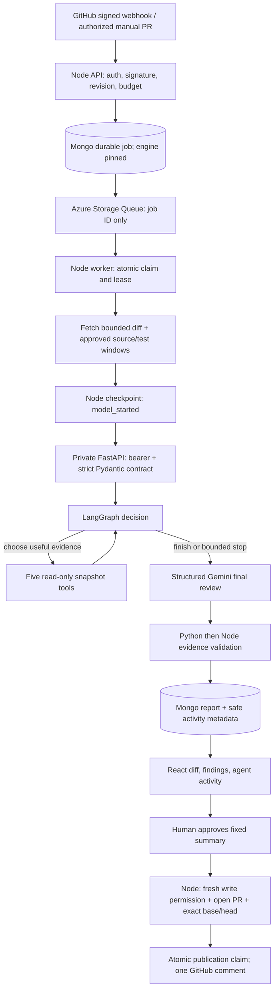

# Bounded Python review agent

The Python agent is implemented and deployed privately in the current Azure demo. New hosted jobs select `python-agent`; existing jobs retain their pinned engine. Fresh installations still default to `legacy` unless explicitly configured. A scripted demo proves wiring and guardrails; cloud activation and actual provider results are recorded separately in [the verification ledger](FEATURE_ROADMAP.md).

## Architecture and responsibilities



**Node** keeps auth, GitHub credentials, queue/recovery, deterministic checks, report storage and external writes. **Python** receives one already-authorized snapshot and chooses which evidence to inspect. No second queue, Python database, browser agent or repository execution was added. Redis is not used by this path.

The model selects structured actions; plain Python functions execute the allowlisted tools. `TypedDict` describes internal graph state; Pydantic validates the external request and model decisions. This separates readable application code from framework code.

| File/module | Responsibility |
|---|---|
| `agent-service/app/main.py`, `config.py` | App factory, health and explicit environment configuration |
| `app/review/routes.py`, `schemas.py` | Private HTTP authentication, bounded input, strict contracts |
| `app/review/workflow.py` | Decisions, tool rounds, shared budgets and stopping conditions |
| `app/review/tools.py`, `retrieval.py` | Five functions and scoped lexical ranking |
| `app/review/llm_client.py` | Gemini adapter only; structured JSON, no SDK retries or raw transcript retention |
| `app/review/validation.py` | Exact evidence, changed-line finding and walkthrough checks |
| `app/review/metrics.py` | Shared token accounting and optional dated cost estimates |
| `evaluations/run.py` | Offline fixtures, exact-run quality scoring and opt-in evaluation CLI; outside the runtime app |
| `server/src/features/ai/ai.agent.js` | Private endpoint policy, request preparation, second independent validation |
| `server/src/features/analysis/analysis.workflow.js` | Existing durable model/save boundary |
| `analysis.jobs.js`, `analysis.repository.js` | Existing queue claim/lease and persisted engine selection |
| `analysis.publication.js` | Human-approved fixed summary and uncertain-write reconciliation |
| `client/.../report/AgentActivity.jsx`, `ReviewApproval.jsx` | Metadata and explicit approval UI |

## The five tools and their actual scope

| Tool | Useful question | Permission boundary |
|---|---|---|
| `inspect_pr_snapshot` | What changed and what is the PR intent? | Supplied intent/file list only |
| `read_source_window` | What is around this source line? | Known source ID, approved range, at most 60 lines |
| `find_related_tests` | Do nearby tests describe this contract? | Changed file and explicitly related supplied test windows; never executes tests |
| `search_review_context` | Which supplied source is relevant to this term? | Stable keyword ranking over approved chunks, top 1–4 |
| `run_review_rules` | Which deterministic signals deserve investigation? | Node's supplied heuristic findings, optionally one changed file |

The agent cannot fetch arbitrary URLs, read local files, run shell commands, clone repositories, apply patches or merge PRs. Source instructions are untrusted data. Structural allowlists enforce scope even if the model follows an injected instruction.

Node tries at most two deterministic nearby test paths across the entire review, sharing the existing eight GitHub content reads. Both candidates can be spent on the first eligible file; tests for later files, other folders or naming conventions may be missed. Omissions remain visible. Existing optional semantic retrieval remains available to the legacy path. The new agent's default retrieval uses approved source chunks and keyword matching, without embeddings or a vector database.

## Limits and failure behavior

- Existing bounds remain: 5 changed files, 4,000 serialized characters/file, 12,000 serialized diff characters, 8,000 context characters, at most 16 source chunks. Characters are not tokens.
- At most **2 decision rounds, 4 tool executions, 3 provider requests including retries**. One request is reserved for the final review. Decision output is capped at 2,048 tokens; final output at 8,192, shared by hidden reasoning and visible report JSON. Earlier 512/4,096 caps left too little space for complete structured output after thinking. Provider finish reasons are recorded; `MAX_TOKENS` returns unavailable with `MODEL_OUTPUT_TRUNCATED`/`output_limit`, without retry or a misleading clean review.
- Shared agent deadline: 90 seconds; each provider request: at most 30 seconds or remaining time. Node HTTP: 150 seconds, covering private service cold start. SDK retries are disabled. Only one explicitly rejected 429 may retry within remaining budgets.
- Invalid decisions stop; invalid findings/review evidence cannot become successful AI output. Repeated tools, no matches, exhausted budgets and missing context are recorded. A partial result is not full repository coverage.
- Provider timeout, ambiguous transport/server failure or lost Node/Python response becomes **unknown**. Node never retries the HTTP POST or silently chooses another provider. Existing checkpoint guard blocks model replay.
- The job pins its engine when created. Old jobs without a field stay legacy, including on operator resume. Changing `REVIEW_ENGINE` affects newly created jobs, not existing ones.
- Python has **no durable mid-loop resume**. If it finishes but the response is lost, the result may be lost. Existing Mongo checkpoints can recover the validated model/save boundary; they cannot recover an unreceived Python result. A fresh deliberate review may cost again. Use a new revision or the existing authorized `@prism-ai full review` command; opening an old report does not rerun AI.

This provides conservative at-most-once attempts at uncertain boundaries, not exactly-once model billing. Queue delivery remains at least once; atomic claims and durable IDs protect the processing boundary.

## Review-quality controls

The `bounded-review-v3` rubric in `app/review/prompts.py` asks the model to investigate behavior before summarizing: compare requirements and related tests, check applicable conditions/boundaries/auth/state/error paths, find a concrete trigger and consequence, then challenge the candidate's assumptions. Missing helper behavior is a limitation, not proof of a bug. Hypothetical malformed input needs a supplied caller/contract/data-flow basis before it becomes a finding. Empty findings do not mean code was proven correct. This is prompt/context engineering, **not model-weight fine-tuning**.

Selected context is supplied as explicit numbered lines with source identity/revision, keeping quote coordinates clear. Read-window bounds stay enforced; instructions do not grant additional source access. Final structured-output schema restricts walkthrough file paths to actual changed files; retrieved tests/context can still be cited as evidence. This prevents the observed failure where an unchanged test was incorrectly listed as a changed file. Independent validators remain authoritative. The adapter keeps private reasoning out of output and logs.

For configured Gemini 3 models (including SDK-supported `models/` resource prefixes), planning uses `low` thinking and the final review defaults to `medium`. Set server-owned `PRISM_AGENT_THINKING_LEVEL` to `minimal`, `low`, `medium`, `high`, or `provider` (provider default/compatibility opt-out). Unsupported values fail configuration before a model call. Other model families keep their provider default; their support must be evaluated separately. Reports retain requested effort and prompt revision; effort is not a calibrated quality score. Reasoning consumes billable tokens and can increase latency; finite request/time/output limits remain necessary. `medium` is the conservative local default after the small high-effort trials produced unsupported findings; grouped prompt/config changes mean this is not an isolated causal benchmark of thinking levels.

The same cheap/lightweight model can improve with better instructions and reasoning settings, but more reasoning can also produce noisy findings. We retain known-bug, correct-code, injection-context and missing-context cases plus separate null-guard/expiry pairs. Live runs must preserve unavailable/truncated results and be assessed for both missed bugs and false positives; tool use or exact citations alone are insufficient. A stronger model comparison is a separate explicit decision, not a silent fallback.

## Human approval

Agent reports suppress automatic summary, inline review and advisory-status writes, regardless of the legacy opt-in flags. Existing opted-in email behavior is unchanged. Read tools require no approval because they only inspect the authorized snapshot.

`POST /api/analyses/:id/publication` accepts **only** `{ "decision": "approve" }` or `reject`. Existing session/origin middleware applies. A fresh user repository lookup requires write permission; a fresh installation token and open PR with matching base/head are required. Node generates the exact fixed preview; arbitrary comment text is not accepted. It contains counts, AI status/provenance and an access-controlled report link, not source or finding text.

Mongo atomically claims `pending → publishing`. Duplicate approval cannot create a second write. A lost POST response leaves `unknown`; another explicit action only scans the stable marker from the configured GitHub App, without posting again. A `publishing` result older than three minutes can likewise be reconciled. Marker scans stop at 300 comments. Unknown without a found marker stays unknown. Rejection is final for that report.

There is an unavoidable race if a PR changes after the final GitHub read but before the comment write. The comment remains advisory and links to a saved revision; it grants no merge approval. GitHub comment creation and Mongo updates cannot share a transaction.

## Run the free local fixture

Prerequisites: Node dependencies installed (`npm ci --prefix server`, `npm ci --prefix client`), Python 3.12+ and uv. Commands below run owned fixtures, not live GitHub or paid inference.

Terminal 1, repository root:

```powershell
Set-Location agent-service
uv sync --frozen
uv run uvicorn tests.http_fixture:app --host 127.0.0.1 --port 8090 --no-access-log
```

Terminal 2, repository root:

```powershell
npm run build --prefix client
node server/scripts/agent-demo.js
```

Open **http://127.0.0.1:5055/analyses/agent-local-fixture**. This exercises real Node → HTTP → FastAPI → LangGraph tools → Node evidence validation → saved local report → React. The SDK response and GitHub reads are substituted with owned fixtures and explicitly labelled. Approving here is denied because this fixture has no real GitHub session; external-write behavior is tested with mocked GitHub transport. Both services bind to loopback. Stop with Ctrl+C.

## Configure real inference separately

Python reads environment variables; it does not automatically load an `.env` file:

| Process | Variables |
|---|---|
| Python | `PRISM_AGENT_SERVICE_TOKEN` (32+ characters), explicit `GEMINI_API_KEY`, explicit `PRISM_AGENT_MODEL` |
| Node worker | `PRISM_AGENT_URL`, same `PRISM_AGENT_SERVICE_TOKEN` |
| Node job creator | `REVIEW_ENGINE=python-agent` to opt in new jobs |
| Optional cost | Python `PRISM_AGENT_PRICES_JSON`: `model`, `asOf` date, `inputUsdPerMillion`, `outputUsdPerMillion` |

Use `uv run uvicorn app.main:app --host 127.0.0.1 --port 8090 --no-access-log` for the real adapter, with those variables set privately. Keep existing Node GitHub App/session/queue setup. API credentials and GitHub tokens are not forwarded to Python. No hosted fallback is automatic.

Production endpoint policy accepts the app's internal Azure Container Apps FQDN; development also accepts loopback. Redirects, userinfo, query strings and other hosts are rejected before sending the bearer token. Body limit is 256 KiB; Node response limit is 128 KiB.

Rollback: set new-job selection back to `REVIEW_ENGINE=legacy`. Do not rewrite queued jobs or replay uncertain ones. Keep Python available until its already-pinned jobs finish or are deliberately retired.

## Evaluation and observability

`docs/beta/agent-evaluation-cases.json` freezes four authored cases: broken policy, correct policy, malicious context instructions and missing helper context. Expected issue IDs are reference labels, not measured model results. Invalid tools, transport uncertainty and wrong evidence are separately covered by executable tests.

From `agent-service/`:

```powershell
uv run python -m evaluations.run --output "$env:TEMP/agent-evaluation-scripted.json"
# Explicit paid opt-in only; requires the privately configured key/model:
uv run python -m evaluations.run --mode live --allow-paid --output "$env:TEMP/agent-evaluation-live.json"
```

The first command exercises real graph/tools using authored model output. It reports **null precision/recall**, not a quality score. To judge a frozen run, copy `runId` and `datasetSha256` into this worksheet; include every case and label every returned finding:

```json
{
  "runId": "COPY_FROM_RUN",
  "datasetSha256": "COPY_FROM_RUN",
  "cases": [{ "caseId": "A01", "reviewed": true,
    "findings": [{ "index": 0, "verdict": "correct", "issueId": "draft-bypass" }] }]
}
```

Use `verdict: "incorrect", issueId: null` for a false positive; a missed expected issue affects recall. Empty finding arrays still need a reviewed case. Duplicate/foreign/stale labels are rejected. Score without new inference using `uv run python -m evaluations.run --run "$env:TEMP/agent-evaluation-live.json" --judgments PATH --output "$env:TEMP/agent-evaluation-scored.json"`. Compare models on identical dataset hashes with separate exact-run judgments. Four cases are a small regression fixture, not a benchmark or proof of generalization.

The evaluator stays in `agent-service/evaluations/`, separate from the deployed `app/`. Runtime diagnostics import `app/review/metrics.py` directly and never import evaluation fixtures or scoring code. Existing captured run IDs and dataset hashes remain historical evidence; reorganizing modules does not regenerate or relabel those runs.

Each attempt records status, duration and reported usage. Counters are captured from the public provider SDK before LangChain normalizes missing fields into zero. Input, candidate output, thinking and total remain separate. Failed requests with absent usage keep totals/cost unknown; known subtotals do not become complete totals. Optional dated prices must match the exact model; candidate output plus thinking are counted once at the configured output rate, only when all three billable counters are known. Estimates exclude infrastructure, discounts and other billing adjustments. Confidence remains conservative `low`, not a calibrated probability.

The `prism.agent` logger emits only run ID, outcome/provenance, stop reason, counters, timing, usage and estimated cost. It does not enable global HTTP/debug logging. LangSmith tracing is disabled around the private graph and model; existing Node metadata-only trace export stays optional. No prompts, model arguments, raw source windows or chain-of-thought are logged. Validated evidence quotes remain in access-controlled saved reports by design.

## Docker and Azure

Build `docker build -t prism-agent:local agent-service`. The image copies only locked dependencies and `app/`, runs as non-root and excludes tests, credentials and local artifacts. Its health route makes no inference call.

`infra/main.bicep` adds an optional internal Container App, min 0/max 1, separate secure service-token and model-key references, and worker-only private HTTP credentials. Activate with `reviewEngine=python-agent`, immutable `agentImage`, explicit `agentModel`, secure `agentServiceToken` and `agentApiKey` parameters. Defaults preserve legacy deployment. Do not put secure values on a shared command line or commit parameter files. The Python service gets no Mongo or GitHub credentials. Health is liveness, not proof of provider access.

Scale-to-zero still has cold-start latency; storage/active compute/provider calls can cost money. Production uses the internal HTTPS FQDN and rejects plaintext endpoints before sending the bearer/source. TLS terminates at Container Apps ingress; the process listens on its internal HTTP target port. The existing public webhook cold-start limitation is unchanged. No Azure resources are deployed by building the Bicep template.

For the first rollout, provision the private agent and verify startup before updating the worker, then opt the API into new agent jobs. Keep old jobs' engine values unchanged. The GitHub manual release workflow can subsequently update an already-provisioned agent through `AZURE_AGENT_APP_NAME`; it does not provision its secrets or switch engines automatically.

## Verification and the 12-point checklist

Run `./scripts/verify-local.ps1`; optional `-Integration` requires local Mongo on 27017 and Azurite queue on 10001, using isolated random test databases/queues. Optional `-Docker` builds both images. Tests substitute provider/GitHub network calls and do not load the project's `.env`.

| Checklist | Implemented evidence | Verification boundary |
|---|---|---|
| Real user/problem | GitHub PR author/reviewer, existing workflow | Existing product |
| Python + FastAPI | Private route, app factory, strict contract | Local HTTP + container |
| LLM + structured output | Explicit Gemini adapter + typed decisions/final schema | SDK-wire tests and final real Node/HTTP/Gemini smoke: one supported policy finding and completed review; earlier failures retained |
| Useful retrieval | Scoped source windows, related tests, lexical ranking | Owned context fixtures; no whole-repo search |
| 3–5 tools | Five allowlisted read-only functions | All tested; no repository execution |
| Multi-step state | Per-request LangGraph + existing durable Node boundary | Real graph and Mongo checkpoint checks |
| Errors/retry/stops | Shared budgets, explicit 429, unknown outcomes | Offline failure tests |
| Human approval | Fixed summary, fresh permissions/revision, atomic claim | Real Mongo concurrency; GitHub writes mocked |
| Evals/results | Frozen cases + strict exact-run human judgments | Repeated four-case live trials and four additional null/expiry cases; one uncertain case retained, independent human precision/recall still unknown |
| Traces/logs/cost/latency | Safe metadata, per-attempt usage, dated optional estimates | Local records; no paid tracing requirement |
| Docker/demo | Separate non-root Python image, private Azure app and queue worker | Actual hosted changed-line regression identified with validated review; partial related-test coverage. See release ledger for earlier failures |
| Diagram/README | This architecture, contracts and learning map | Documentation linked from root README |

Current command results and release limitations are tracked in `docs/FEATURE_ROADMAP.md`. No commit, push or cloud activation is implied by local checks.

For a hosted bug-discovery smoke test, use an owned test branch and change an actual logic line. A comment-only push creates a fresh revision but can produce an incremental diff containing only comments. A defect in unchanged context is then outside the allowed finding lines; rejecting that citation is intentional. A fresh revision alone does not guarantee a new AI finding, and a clean change may correctly return none.

The complete live quality investigation, failed intermediate runs, reasoning trade-offs and model limits are documented in [Review quality](REVIEW_QUALITY.md).

## Read the code in this order

1. Follow `prepareAgentRequest` and the shared request JSON: identify exactly which fields cross the boundary.
2. Read one tool and its test. Try a foreign source ID; explain why it is denied.
3. Read `decide → tools → decide → draft` in `app/review/workflow.py`. Trace how a 429 consumes the same request budget.
4. Read `app/review/llm_client.py`, `validation.py` and `metrics.py`: separate provider output, evidence validation and honest usage/cost accounting.
5. Run the free `evaluations.run` command above. Follow its authored `FixtureModel` through the real workflow; explain why null precision/recall does not establish live model quality.
6. Follow a lost response through `INTERRUPTED_MODEL_REQUEST` to the owner-checked unknown job and Node checkpoint guard.
7. Follow approval from the React button to fresh GitHub permission, atomic claim and one fixed write. Explain why unknown can only reconcile.

Primary references: [LangGraph workflows and agents](https://github.com/langchain-ai/docs/blob/main/src/oss/langgraph/workflows-agents.mdx), [LangChain model configuration](https://github.com/langchain-ai/docs/blob/main/src/oss/langchain/models.mdx), [Azure internal app communication](https://learn.microsoft.com/en-us/azure/container-apps/connect-apps), [Azure ingress](https://learn.microsoft.com/en-us/azure/container-apps/ingress). Runtime details are additionally checked against this repository's locked SDK source and transport tests.
