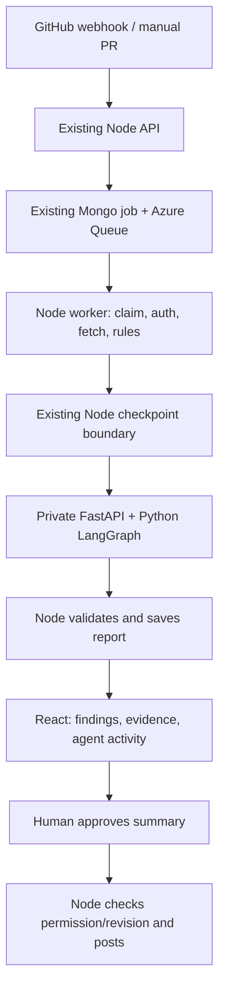

# Prism AI: simple Python review agent design

**Status:** Simple design approved by owner and implemented locally on 18 November 2026. Local verification and limitations: [agent guide](../../PYTHON_REVIEW_AGENT.md). Not deployed.
**Date / source baseline:** 18 November 2026 / `64ee604`.
**Owner feedback:** Features useful rahen, lekin code aur roadmap beginner-readable ho.

## 1. Hum kya bana rahe hain?

Existing Node backend, React UI, MongoDB aur Azure Queue rahega. Ek private Python/FastAPI service add hogi. Uske andar LangGraph agent decide karega ki PR samajhne ke liye kaunsa evidence tool use karna chahiye. Node result validate/save karega; UI findings aur agent ki activity dikhayegi.

**Demo:** Agent changed condition dekhe, related test/source inspect kare, relevant code cite karke finding de aur stop ho. Context missing ho toh limitation bataye. GitHub summary publish karne se pehle authorized human approval ho.

Original 12 checklist points rahenge. Python ke har intermediate step ko crash ke baad resume karna simpler proposal mein included nahi hai. Existing Node recovery reuse hogi; yeh explicit trade-off hai, hidden feature deletion nahi.

## 2. Pehle draft ka rethink

| Earlier draft | Simpler recommendation |
| --- | --- |
| Node + Python dono mein persistent run/checkpoint lifecycle | Durable jobs/checkpoints existing Node mein; Python state per request |
| Custom snapshot hashing, `snapshotJson`, `agentRunRef` | Normal JSON with explicit repository/revision/source references |
| Python create/status/resume APIs | One review endpoint plus health; browser existing Node API use kare |
| Separate publication collection + preview-hash protocol | Saved immutable report par small publication field + atomic claim |
| Lots of plumbing before useful output | Small functions; working review path first |

Earlier full Python recovery design possible hai, lekin substantially more implementation/testing chahiye. **Selected: simpler option**, explicitly approved by the owner.

**Necessary cheezein retain:** authorization, exact revision checks, input limits, duplicate-job claim, finite model calls aur safe GitHub writes. Inko remove karna code simpler dikhayega, behavior correct nahi banayega.

## 3. Flow aur responsibilities



- **Node:** login, signed webhooks, repository access, queue/jobs, source fetching, rules, reports and external delivery.
- **Python:** JSON validation, tool selection, bounded retrieval, model requests and structured AI result.
- **React:** two small report components for activity and approval. Homepage redesign nahi.
- **Mongo/Azure:** existing infrastructure reuse. Python ko separate Mongo checkpoint store nahi chahiye.

Existing `runReviewWorkflow` ka review callback either legacy Node AI or Python agent call karega. Node graph outer request/save recovery guard hai; Python graph investigation decisions karta hai. They do not independently retry the same inference operation.

## 4. Five tools = five small Python functions

Node authorized PR se bounded, sanitized data dega. Har source ko request-local ID milegi, e.g. `source-1`. Tools usi request ki source list access karenge; arbitrary path, URL, repository or revision allowed nahi.

| Function | Useful job |
| --- | --- |
| `inspect_pr_snapshot()` | Supplied PR metadata, changed-file map aur diff summary |
| `read_source_window(source_id, start, end)` | Approved interval se numbered lines; max 60 lines / 2,500 characters |
| `find_related_tests(file_id)` | Supplied relationship map se relevant test candidates; tests execute nahi |
| `search_review_context(query, k)` | Max 16 scoped chunks se top `k <= 4` matches; query max 300 characters |
| `run_review_rules(file_id)` | Node-computed deterministic signals; vulnerability proof nahi |

`tools.py` mein plain functions + explicit name-to-function dispatch enough hai. No plugin framework, abstract class hierarchy, dynamic discovery or shell tool.

Node limited related test filenames try karega (`foo.test`, `foo.spec`, `test_foo`). Existing 8 context reads mein at most 2 test lookups ke liye; existing 8,000-character context allowance shared. Missing/sensitive/oversized tests omissions banenge. Whole repo crawl nahi.

**Scoped RAG:** `retrieval.py` supplied chunks ko keyword relevance se rank karega; selected source final model context mein jayega. Default ke liye embeddings/vector DB mandatory nahi. Existing optional semantic path optional rahega; actual mode visible hoga.

LLM useful tool choose karega, result dekhega aur next action/finish decide karega. All five tools ko fixed order mein chalana agentic behavior nahi maana jayega.

## 5. Validation aur state ko simple rakho

**Pydantic:** JSON shape/type check. Line positive integer ho; tool name allowed ho; extra scope fields reject hon. Valid JSON semantic truth prove nahi karta; evidence checks separate rahenge.

**Typed state:** normal dictionary ka documented shape: `rounds`, `tool_calls`, `selected_sources`, `events`, `stop_reason`, `result`. Graph nodes normal functions honge. No generic framework or complicated inheritance.

**Private API:** `POST /v1/reviews` gets review ID, engine/schema version, installation/repository/base/head scope, sanitized intent/files/snippets, relationships, rules and coverage. `GET /health` is liveness. Review request requires a service token.

- Normal JSON; custom serialized snapshot string/hash protocol nahi.
- Body max **256 KiB**. Reject unknown fields, invalid scope/source/ranges and unauthorized tool arguments.
- Budgets/provider/model server-controlled; model/request permissions increase nahi kar sakta.
- Node response scope/version + existing finding/review validators check karega.
- GitHub credentials Python ko nahi bhejenge. Production private HTTPS; local loopback allowed. No caller-selected callbacks or public browser access to this service.

## 6. Small LangGraph loop and limits

**decide -> execute tools -> decide again OR draft -> validate -> return**

Decision: at most two allowed tool actions, or finish. Pydantic checks structure; tool functions check source access. Final review uses the existing Node-compatible structured format.

Proposed demo defaults:

- **2 decision rounds, 4 tool executions, 3 model requests total**, retries included. Reserve one request for final review.
- Decision output max **2,048 tokens**; final max **8,192 tokens** shared with hidden reasoning. Originally 512/4,096; increased during owner-authorized quality repair after thinking-enabled responses exhausted those allowances. Configured Gemini 3 planning uses low thinking; final review defaults medium with a server-owned provider-default opt-out. Explicit model settings; missing usage is not zero.
- Total **90 seconds**; one model attempt at most **30 seconds** or remaining deadline. Node HTTP timeout **150 seconds**; existing worker timeout 600 seconds.
- Stop for enough evidence, repeated tool request, no new context, invalid output or exhausted budget. Save the reason.
- SDK auto-retries off. Explicit rejected 429 can retry once only within remaining time/request limits. No blind inference retry for timeout, lost response or ambiguous 5xx.
- Gemini-first, explicit configured model/key. Other providers stay available in legacy mode; no silent fallback.

No agent swarm, recursive self-repair or repeated LLM judge in normal review execution.

## 7. Recovery: reuse Node, acknowledge the limit

- Persist selected engine on job creation. Existing jobs without engine remain legacy; resume engine silently switch nahi karega.
- Existing atomic Mongo claim protects competing workers. Python client sends one POST; HTTP retries/fallback disabled.
- Existing Node request-boundary checkpoint persists before Python call.
- Pre-request crash can use supported Node resume. A crash/lost response during Python call is uncertain: record job status `unknown` with an interrupted-request code; existing guard blocks blind replay. This needs a small owner-checked job update, not another run-store. Known explicit AI failure may return unavailable AI with rule findings. Do not turn an uncertain call into a completed AI report.
- If returned result reached Node's reviewed checkpoint or saved report, existing recovery can reuse it.

**Limitation:** Python process crash ke baad middle tool-loop resume nahi hoga. Response Node checkpoint tak na pahunche toh result lost ho sakta hai. Fresh deliberate review extra cost kar sakta hai; use new revision or existing authorized `@prism-ai full review` comment identity. Old report reopen karna retry nahi.

No exactly-once billing guarantee. Python step-level persistent resume future option hai, current promise nahi. Raw source bundles/transcripts archive nahi honge; safe activity metadata + validated final evidence report mein save honge.

## 8. Human approval: one real action

Agent reports automatic GitHub summary/inline posting suppress karenge; existing legacy delivery unchanged. Existing opted-in emails remain Node/user preference, not an agent tool.

One report field: publication `pending`, `publishing`, `published`, `rejected`, `unknown`, plus approver/time/comment reference. No new approval service or collection.

1. UI saved report se derived fixed summary preview dikhaye.
2. Human approve/reject; Node authenticates and verifies current repository write permission.
3. Approve atomically claims `pending -> publishing`; recheck PR open + reviewed base/head unchanged.
4. Post bot comment with stable marker; persist outcome. Duplicate approve returns existing outcome.
5. Uncertain write stays inspectable; read-only marker inspection may reconcile it. Do not blindly POST again.

Node generates content from immutable saved report; arbitrary client-provided comment body accept nahi. No patch apply, merge or native LangGraph human-interrupt claim in this release. Approval Node owns because permissions/reports/writes already wahi hain.

## 9. Evaluation, cost aur activity

Reuse frozen evaluation fixtures/scorer. Add agent cases for useful related context, missing context, injection, invalid tools and interrupted requests. Expected labels separate; human judges correctness. Matching a line or calling a tool alone is not a correct finding.

Compare legacy/agent on same owned cases. Precision/recall unknown until judgments complete; no automatic quality/cost improvement claim.

For every provider attempt, record status, duration and supplied input/output/thinking usage. Missing usage `null`. Estimated model cost may use configured model/date/currency rates; missing inputs mean unknown estimate. Azure/storage/network bill alag hai. No new billing platform.

UI activity list shows tools, safe source references, time, tokens and stop reason. No raw prompts/source/query/transcripts/secrets/chain-of-thought in logs. Existing optional metadata tracing stays optional; no compulsory paid observability service.

## 10. Small, feature-based structure

```text
agent-service/
  pyproject.toml / uv.lock / .env.example / Dockerfile
  app/
    main.py                  # app factory/bootstrap/lifespan/health
    config.py                # server configuration
    review/
      routes.py              # private review endpoint
      schemas.py             # Pydantic request/decision/result
      workflow.py               # dictionary state + nodes/edges
      tools.py               # five functions + safe dispatch
      retrieval.py           # bounded keyword ranking
      llm_client.py               # Gemini calls + usage
  tests/
```

No Python repository/custom saver/replay/hash layers. Helpers split when actual responsibility/size justify kare, har function ki separate file nahi. Node gets focused agent client/preparation and publication modules; React gets `AgentActivity` and `ReviewApproval`. Shared safe JSON fixtures verify the HTTP contract.

Python 3.12+, FastAPI, Pydantic v2, LangGraph, Gemini LangChain adapter, pytest/httpx and uv lockfile. Python Mongo dependency not required. Pin/test actual versions during implementation. Simple callable injection se fake-model tests possible hon; elaborate adapter framework nahi.

## 11. Five practical phases

| Phase | Working output | Meaningful checks |
| --- | --- | --- |
| 1. API + tools | Safe fixture accepted; five tools/retrieval work | Auth, schema, size/scope, line bounds, missing context |
| 2. Agent loop | Model chooses tools; structured review returns | Scripted routing, bad JSON/args, limits/timeouts; real adapter smoke separate |
| 3. Product integration | Existing worker uses engine; report/activity visible | Duplicate/restart regressions, real local HTTP, UI/evidence |
| 4. Approval + evals | Human publishes summary; usage/quality records usable | Permission/stale/duplicate/uncertain POST; judgment worksheet |
| 5. Demo + docs | Local Docker demo; Azure config, README/diagram | Local suites/build, isolated integration, browser walkthrough; live rollout separate |

All 12 points: **1** existing PR-review problem/user; **2** FastAPI phase 1; **3** LLM/structured output phase 2; **4** retrieval phase 1; **5** tools phase 1/2; **6** per-run LangGraph state + existing durable Node state phase 2/3; **7** failures/retries/stops phase 2/3; **8** approval phase 4; **9** evals phase 4; **10** logs/cost/latency phase 3/4; **11** Docker/demo phase 5; **12** README/diagram phase 5.

Har phase samajhne aur demo karne layak result de. Local automated tests + manual browser checks; GitLab CI unavailable ka matlab only manual testing nahi. Paid-model/load/GitHub write tests routine suite mein nahi.

## 12. Limits and existing verification

- No new Redis/Celery, mandatory vector DB, whole-repo indexing, shell execution or auto-merge.
- Existing five-file / 12,000 diff-character / 8,000 context-character bounds retained; omissions visible.
- Private FastAPI extra cold-start/failure/cost boundary hai. Retain review allowance; exact INR200/month promise nahi. Cloud activation requires actual cost/configuration review.
- The design-only revision made no application changes. Implementation followed owner approval; see the agent guide and feature ledger for current verification. Earlier hash/Python resume proposals remain superseded, not implemented.

Earlier in this planning session, on unchanged application source: backend **172 passed / 1 opt-in integration skipped / 0 failed**; frontend **61 passed**; Python scorer **7 passed**; client build passed. Existing suites ke results hain, new agent verification nahi. Documentation-only change ke liye unko new-feature evidence mat bolo.

## 13. References and next step

Primary references already checked during this design session: [LangGraph workflows/agents](https://docs.langchain.com/oss/python/langgraph/workflows-agents), [persistence](https://docs.langchain.com/oss/python/langgraph/persistence), [FastAPI background-task caveat](https://fastapi.tiangolo.com/tutorial/background-tasks/#caveat), [Pydantic strict mode](https://docs.pydantic.dev/latest/concepts/strict_mode/), [Gemini integration](https://docs.langchain.com/oss/python/integrations/chat/google_generative_ai). References inform design, not proof of installed/live behavior.

**Recommendation:** simpler proposal above; core checklist retained, Python mid-loop persistent resume intentionally excluded. Read-only builder review checks necessary failure boundaries and material unanswered questions.

Owner instruction: "Simple design approved, implement karo". Concrete task-by-task execution is recorded in `docs/superpowers/plans/2026-11-18-bounded-python-review-agent.md`; verification evidence must distinguish local fixtures, integrations and live providers.
